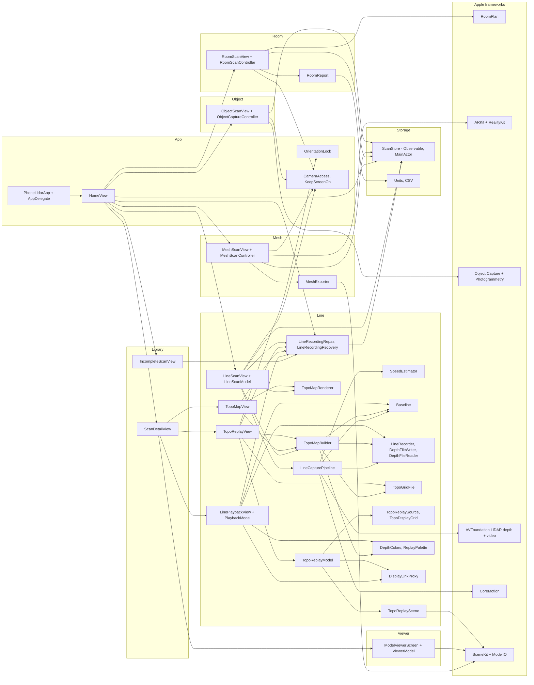
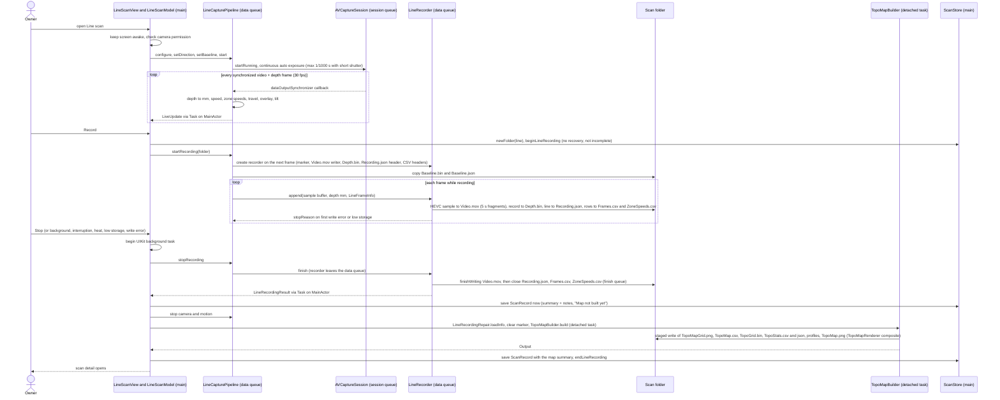
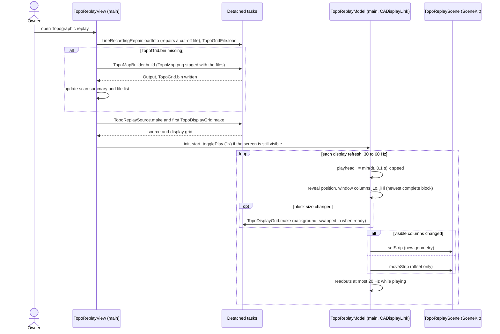
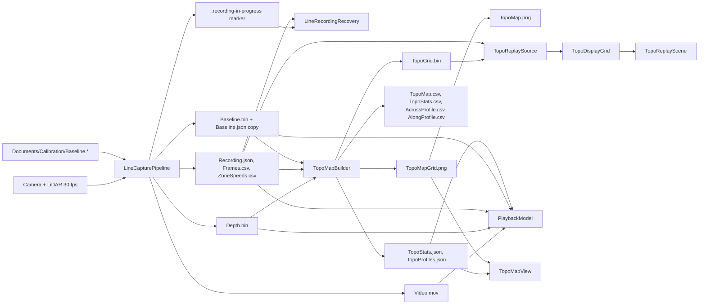

# Phone LiDAR — Design

| | |
|---|---|
| Document | Architecture, module design, data flow, concurrency, algorithms, on-disk formats, technology choices, risks |
| Describes | `main` at `4fa93c7` (PR #9, CI build #61): build #23 plus the P8 changes (unit tests, CI hardening, M1 review fixes of cycles 1–3, the final review and the re-reviews). |
| Date | 2026-11-10 |
| Related | [requirements.md](requirements.md), [implementation-plan.md](implementation-plan.md), [../CLAUDE.md](../CLAUDE.md) |

Source paths are relative to `PhoneLidar/` unless they start with `Support/`, `.github/` or `project.yml`. Review IDs (`A-1`, `B-4`, `C-2`, `P-1`, `F-6`, …) refer to the M1 review ([reviews/2026-11-10-M1.md](reviews/2026-11-10-M1.md)). This document describes the code after the M1 fixes (cycles 1–3, final review and re-reviews); where it says "was" it names the behaviour of build #23. The user guide is [`../README.md`](../README.md).

---

## 1. Scope

The app has four capture modes and shared library functions. Room, Equipment and Object capture are thin wrappers around Apple frameworks plus exporters. Line scan is the bulk of the code (more than two thirds of the Swift code): a real-time capture pipeline, a speed estimator, a calibration model, a streaming recorder with custom binary formats and crash recovery, a playback screen, a map builder with statistics, and a SceneKit replay. `Tests/PhoneLidarTests` covers the pure-logic files in a host-less XCTest bundle.

## 2. Architecture overview

A single-scene SwiftUI app. `ScanStore` (main actor, `@Observable`) owns the list of saved scans and is injected through the SwiftUI environment. Each capture mode is a SwiftUI view with an `@Observable` controller on the main actor; device frameworks are bridged with `UIViewRepresentable`. Line scan moves frame processing to two serial dispatch queues; heavy post-processing runs in detached Swift tasks.



## 3. Modules

### 3.1 App (`App/`)
- `PhoneLidarApp` — `@main`; creates `ScanStore` and injects it; installs `AppDelegate` through `@UIApplicationDelegateAdaptor`.
- `AppDelegate` + `OrientationLock` — `supportedInterfaceOrientationsFor` returns `OrientationLock.mask` (default `.portrait`). `OrientationLock.allow(_:rotateTo:)` changes the mask, calls `setNeedsUpdateOfSupportedInterfaceOrientations()` and `requestGeometryUpdate`. `Info.plist` lists portrait and both landscapes so the replay can rotate.
- `HomeView` — navigation stack keyed by scan `UUID`; new-scan rows gated by capability checks; capture screens in `fullScreenCover`; `finished(_:)` closes the cover and pushes the new scan after 450 ms. Saved scans use `swipeActions` without full swipe and one `confirmationDialog` for scans and incomplete scans (C-8); an **Incomplete scans** section lists `store.incomplete`; a **Line recordings** section shows `store.recoveryNotice` (recovery messages and a failed summary update after Stop). It calls `store.recoverLineRecordings()` when the library loads, when the scene becomes active and when a capture cover closes.
- `CameraAccess` / `CameraDeniedView` — `AVCaptureDevice` authorization check (asks the first time) and the "Camera is off" screen with an Open Settings button, used by Room, Equipment and Object capture; Line scan has its own banner and button (A-9, C-5).
- `KeepScreenOn` — `View.keepScreenOn()` sets `UIApplication.isIdleTimerDisabled` on appear and clears it on disappear (Room, Equipment, Object; C-4). Line scan sets and clears it itself for the whole screen (P-6).

### 3.2 Storage (`Storage/`)
- `ScanStore` — root `Documents/Scans`. `newFolder(kind:)` creates `<kind>_<yyyy-MM-dd_HHmmss>` (en_US_POSIX, local time) and appends `_2`, `_3`, … when the name exists; `save(_:)` refreshes `files` (top-level non-hidden regular files except `scan.json`, sorted) and writes `scan.json` atomically, then `reload()`; `reload()` decodes every `*/scan.json` tolerantly, overwrites `folderName` with the real directory name, sorts by `created` descending, and lists every other folder (not one a line recording is writing to) as an `IncompleteScan` (name, date, size, file count, `interruptedRecording` = `line_` folder with the marker and a `Recording.json`). `delete`/`deleteIncomplete` accept only plain names of real (non-link) folders directly under `Scans`; `delete` also requires the folder's `scan.json` to carry the same id, `deleteIncomplete` refuses folders that hold a readable `scan.json` or are being recorded into. `entries(inFolderNamed:)` lists a folder's top-level files and sub-folders (`Images` carries every file inside; `Checkpoint` is left out). Types: `ScanKind` (`room`, `mesh`, `object`, `line`, `unknown`), `ScanRecord`, `PointMeasurement`, `IncompleteScan`, `ActiveFolderSet` (locked set of folders being recorded), `ScanError` (adds `diskFull`); `JSONEncoder.pretty` (pretty, sorted keys, ISO 8601) and `JSONDecoder.iso`.
- `LineRecordingRecovery.swift` (library side, `ScanStore` extension) — `recoverLineRecordings()` runs `LineRecordingRecovery.scan` in a detached `.utility` task inside a `BackgroundActivity` (UIKit background task), adds each recovered recording as a `ScanRecord`, clears its marker, sets `recoveryNotice`/`recoveryFailures`, and re-runs or retries (§6.14).
- `Formatting` — `Units` (m with 3 decimals + ft-in with 0.1 in, carrying 12.0 in into the next foot, sign taken after rounding, "—" for non-finite input; area m² + ft²; `bytes`) and `CSV` (`escape`, `make`, `measurements`, `roomSummary`).

### 3.3 Library (`Library/`)
- `ScanDetailView` — per-scan sections (FR-LIB-01), `ShareLink` for each file, for the `Images/` photos ("Share photos", C-18) and for all files, Quick Look AR preview for USDZ, **Retry reconstruction** for an Object scan without a model (presents `ObjectScanView(resume:)`), or **Add the finished model** when `ObjectPhotos.hasCompleteModel` (non-empty `Model.usdz`, no `Checkpoint/`) — resume then writes the complete record and never rebuilds (G-3); rename alert, delete confirmation.
- `IncompleteScanView` — folder facts, file list with share links, **Recover recording** (calls `recoverLineRecordings()`; shows "Recovering…" and the last failure), delete confirmation; shows "Recording recovered" with a link when the folder has become a saved scan while open.

### 3.4 Room (`Room/`)
- `RoomScanController` — owns one `RoomCaptureView` (created lazily) and a `RoomDelegate` (`NSObject`, `RoomCaptureViewDelegate`, which inherits `NSCoding`). Phases `scanning → processing → review`. `save(store:)` creates the folder, then exports in a detached task (so "Saving…" shows): `Room.usdz` (`.parametric`), `RoomMesh.usdz` (`.mesh`, `try?`: best effort), `CapturedRoom.json`, `RoomReport.csv`, then saves the record; the folder is discarded on failure (C-13). `RoomDelegate` also implements `RoomCaptureSessionDelegate.captureSession(_:didEndWith:error:)`, which reports a session failure to the controller (C-5).
- `RoomReport` — CSV element rows, the totals block (`CSV.roomSummary`) and summary lines; floor area from polygon corners (|Σ cross(pᵢ, pᵢ₊₁)| / 2), fallback width × height.

### 3.5 Mesh (`Mesh/`)
- `MeshScanController` — one `ARView` with manual session configuration (§FR-MESH-01), mesh debug overlay, measuring via `hitTest(…, mask: .sceneUnderstanding)` then `raycast(…, .estimatedPlane)`; markers are `AnchorEntity` spheres (r = 6 mm) and a 2 mm bar. `save(store:)` copies the anchors out of ARKit on the main actor (`MeshExporter.snapshot`), creates the folder, writes the files in a detached task with stage/progress callbacks, writes `Measurements.csv`, saves the record and only then pauses the session; on failure the folder is discarded and the session keeps running (C-6, C-7). The crosshair is a subview of the `ARView`, so it is at the exact sampled point (C-3). `MeshSessionDelegate` reports session failures and interruptions (C-5).
- `MeshExporter` — `snapshot` (`@MainActor`) copies each `ARMeshAnchor`'s vertices, normals and triangle indices into `MeshAnchorSnapshot` values; `write` (any thread) transforms vertices to world space (`transform × v`) and normals by the rotation part, concatenates index buffers with offsets (triangles only), streams OBJ (text, ~1 MB chunks through a `FileHandle`) and PLY (binary LE) and writes USDZ (SceneKit `SCNScene.write`), reporting stage and progress. Reads Metal buffers through `ARGeometrySource.float3(at:)` and `ARGeometryElement.index(primitive:corner:)` (16- or 32-bit indices).

### 3.6 Object (`Object/`)
- `ObjectCaptureController` — creates the scan folder with `Images/` and `Checkpoint/`, starts `ObjectCaptureSession`, mirrors `session.stateUpdates` into `captureState` (the session is not `ObservableObject` in the iOS 26 SDK), and on `.completed` releases the session, writes a first `scan.json` ("Model not built yet.", photos kept) and runs `PhotogrammetrySession` (`.modelFile(detail: .reduced)`), reporting `requestProgress`. The photos are never deleted once the capture is finished: failure or **Stop** → `keepPhotos` writes a record with the reason and offers Retry (`resume(record:)` reruns on a kept `Images/`); a built model whose record cannot be written → `modelNotRecorded` and `retrySave()` rewrites only the record (E-2). `discardCapture()` (Cancel before the capture finishes) deletes the folder; a capture with no photos is removed.
- `ObjectScanView` / `CaptureOverlay` — state-specific buttons and hints; Area mode on iOS 18+.

### 3.7 Viewer (`Viewer/`)
- `ViewerModel` — loads USDZ with `SCNScene(url:)`, OBJ/PLY with `MDLAsset` → `SCNScene(mdlAsset:)` and a grey double-sided material; adds a camera at `centre + (0, 0.6r, 2.2r)` looking at the bounding-sphere centre (fov 55°, zNear 0.005r, zFar 50r); ruler mode hit-tests taps, ignoring marker nodes; turning the ruler off removes a pending first marker, and the trash button is enabled while markers or a pending point exist (C-14). `loadScene` runs in a detached task, then `apply` on the main actor (C-15).

### 3.8 Line (`Line/`)

| File | Responsibility |
|---|---|
| `LineCapturePipeline.swift` | AVCaptureSession setup and format choice, synchronized frame handler, depth → mm, speed scaling, zone speeds, travel, live overlay, calibration capture (and its cancellation), recorder lifecycle (start on the next frame, 3 s start timeout, auto-stop requests), session interruption / runtime-error / system-pressure observers, auto exposure with a 1/1000 s limit, gravity and surface tilt, `LiveUpdate` and `LineCaptureEvent` (`recordingStarted`, `recordingStartFailed`, `stopRecording`, `cameraInterrupted`, `cameraResumed`, `cameraError`, `pressure`) to the UI. Static helpers `fastest` (forwards to `LineMotionMath`, used by playback) and `describe`; the speed, travel, smoothing, median and tilt maths live in `LineMotionMath` (Z-7). |
| `LineMotionMath.swift` | Pure maths used by the pipeline and compiled by the test target (Z-7): pixel shift → mm/s with the depth focal length scaled to video pixels, quality and Δt gates, zone speeds, travel integration with the held speed (on a direction change cleared; at Record kept only if at most 2.0 s old, Z-1/Y-1), 15-frame smoothing, fastest zone and `surfaceTilt` plane fit. Foundation only. |
| `SpeedEstimator.swift` | Luma pyramid and SAD block matching: `process(_:)` → `TextureShift` (main) and `lastTiles` (24 `TileShift?`). Grid constants `tileColumns = 6`, `tileRows = 4`. |
| `Baseline.swift` | `BaselineInfo` (Codable), `Baseline` (immutable values + info; `load`, `save`, `delete`, `heights`, `sample`, `build`, plane fit, 3×3 Cramer solver). |
| `LineRecording.swift` | `LineError`, `TravelDirection`, `LineFrameInfo` (+ `sanitized()`), `LineRecordingInfo`, `LineRecordingHeader`, `LineRecordingResult`, `LineStorage` (free-space thresholds), `SpeedText`, `ZoneGrid` (zone ↔ picture/depth mapping), `LineMath` (centred moving average, frame index by time), `Data` UInt32 LE helpers, `TextFileWriter`, `RecordingJSONWriter`, `DepthFileWriter`, `DepthFileReader`, `LineRecorder` (streams every file, marker, 5 s video fragments). |
| `LineRecordingRecovery.swift` | `LineRecordingRepair` (`loadInfo` reads `Recording.json` and repairs a cut-off file on disk; `repairedData`; marker helpers), `LineRecordingRecovery.scan` (background pass over `line_` folders), the `ScanStore` recovery extension, `BackgroundActivity`. |
| `DisplayLinkProxy.swift` | `CADisplayLink` target that breaks the retain cycle and invalidates the link when its owner is gone (replay clock, playback clock). |
| `LineScanView.swift` | Recording screen and `LineScanModel` (phases `starting, ready, arming, recording, saving, building, failed`; scene-phase handling, camera permission, background task around the save, library entry before the map build), `CameraPreview`, `SpeedSparkline`, `BubbleLevel`, `FastestMarker`. |
| `DepthColors.swift` | Jet palette (`rgb`, 256-entry `lut`), colour index for distance and height, RGBA image builders, P2–P98 range helpers, `DepthLegend`. |
| `LinePlaybackView.swift` | Playback screen, `PlaybackSetup` (read off the main thread), `PlaybackModel` (AVPlayer or frame-time clock, per-frame depth rendering, smoothed speeds, probe), `ProbeStats`, `PlayerLayerView`, `ProbeMarker`, `ProbeTimeline`, `SpeedTimeline`. |
| `TopoMapBuilder.swift` | `ProfilePoint`, `TopoProfiles`, `TopoStats`; `build(folder:info:composite:)` (stitching, `pixelFootprint`, trim, statistics, image, staged write of all map files); text and CSV helpers; summary-line replacement for rebuilds; `writePNG`. |
| `TopoMapRenderer.swift` | `TopoMap.png` composite (title, map, legend, statistics): `compositePNG` returns the data (UIKit drawing, not tied to the main actor); every caller passes it to `TopoMapBuilder.build`, which stages it with the other outputs. |
| `TopoMapView.swift` | Map screen, `ProfileChart` (Swift Charts), `ZoomableImage` (UIScrollView). |
| `TopoGridFile.swift` | `TopoGrid.bin` writer/reader; Float64 LE helpers. |
| `TopoReplayData.swift` | `ReplayPalette`, `TopoReplaySource` (crop, reorder, reveal positions, run-out, defaults), `TopoDisplayGrid` (block averaging, gap fill, smoothing), `ReplayNumbers` (nice numbers, ticks). |
| `TopoReplayModel.swift` | Replay clock (CADisplayLink through `DisplayLinkProxy`), transport, window computation, background display-grid builds, readouts, `saveImage`, header texts. |
| `TopoReplayScene.swift` | SceneKit content: orthographic sheared camera, surface strip with walls, tolerance planes, newest-line bar, axes and billboard labels. |
| `TopoReplayView.swift` | Replay screen: loading (builds the grid if missing), landscape/portrait layouts, `ReplaySceneView` (SCNView + gestures), `AlongChart`, `AcrossPanel`, `ColorBar`, `ReplaySettingsView`, `ActivityView`. |

## 4. Data flow

### 4.1 Line scan: capture → recording files → map → replay





### 4.2 File dependencies



### 4.3 Other modes
- Room: `RoomCaptureView` → delegate `captureView(didPresent:error:)` → `RoomScanController.received` (main) → Save → files + `scan.json`.
- Mesh: `ARView` session → `currentFrame.anchors` (`ARMeshAnchor`) → `MeshExporter` → files + `scan.json`.
- Object: `ObjectCaptureSession` writes photos to `Images/` → `.completed` → `PhotogrammetrySession` → `Model.usdz` + `scan.json`.

## 5. Threading and concurrency

Swift 5 language mode (`SWIFT_VERSION: "5.0"`), so strict concurrency checking is minimal. All `@Observable` models and UI are `@MainActor`.

| Execution context | Owns / runs |
|---|---|
| Main actor | SwiftUI views; `ScanStore`; `RoomScanController`, `MeshScanController`, `ObjectCaptureController`, `ViewerModel`, `LineScanModel`, `PlaybackModel`, `TopoReplayModel`, `TopoReplayScene`; `MeshExporter.snapshot`; `OrientationLock`; `BackgroundActivity`; `LineCapturePipeline.configure` (called from `LineScanModel.openCamera`; F-5, deferred); the UIKit background task around a recording save. |
| `phonelidar.line.session` (serial) | `AVCaptureSession.startRunning/stopRunning`, depth filtering toggle, exposure changes (`applyShutter`), runtime-error restarts (`errorRestarts`, `wantsRunning`). |
| `phonelidar.line.data` (serial, `.userInitiated`) | `AVCaptureDataOutputSynchronizer` delegate; all "data-queue state" of the pipeline: `SpeedEstimator`, travel and smoothing buffers, active `Baseline`, calibration capture, `LineRecorder` (AVAssetWriter appends, `Depth.bin`, `Recording.json` and CSV streaming writes, storage checks) until `stopRecording` takes it off the queue, session-interruption / error / pressure state changes (`awaitingResume`, `autoStopReason`, `overlayStride`). The only user of `CMMotionManager`: it is started, read each frame and stopped on this queue (P-4). |
| `phonelidar.line.finish` (serial, per recorder) | `LineRecorder.finish`: after `finishWriting` of `Video.mov`, closes `Depth.bin`, `Recording.json`, `Frames.csv` and `ZoneSpeeds.csv`, then calls the completion (→ `Task { @MainActor }`). |
| Global queue (`.userInitiated`) | `Baseline.build` after calibration capture; completion hops to the main actor. |
| AVAssetWriter completion queue | `finishWriting` completion → `stopRecording` completion → `Task { @MainActor }`. |
| Detached tasks (`.userInitiated`, recovery `.utility`) | `TopoMapBuilder.build` (after Stop, on Rebuild, on replay open) including the `TopoMap.png` composite (after Stop, on Rebuild and on replay open), `LineRecordingRepair.loadInfo`, `TopoGridFile.load` + `TopoReplaySource.make` + `TopoDisplayGrid.make` (replay open and block-size changes), `PlaybackModel.prepare`, map-screen file loads, `ViewerModel.loadScene`, Room export, Mesh export (`MeshExporter.write`), `LineRecordingRecovery.scan`, probe sampling (`DispatchQueue.concurrentPerform` over frames). |
| Main run loop, `.common` mode | `CADisplayLink` replay clock and playback frame-time clock (preferred 60 / 30 Hz, range 30–60, through `DisplayLinkProxy`); `AVPlayer` periodic time observer (1/30 s, main queue); the AVCapture notification observers (delivered on any queue). |
| SceneKit render thread | Renders `SCNView`s; geometry is replaced from the main actor. |

How frames cross threads:
- AVFoundation delivers a `CMSampleBuffer` and `AVDepthData` on the data queue. The depth map is copied into a `[Float]` of millimetres there; the video buffer is read in place (luma pyramid) and passed directly to `AVAssetWriterInput.append` on the same queue — no hand-off.
- The UI receives a `LiveUpdate` value (numbers plus an immutable `CGImage`) through `Task { @MainActor }`, one task per frame, without coalescing (P-8, deferred). `LineCaptureEvent` values (interruption, error, pressure, stop requests) take the same route.
- Calibration frames (`[[Float]]`) are copied into a `CalibrationCapture` value (marked `@unchecked Sendable`) and handed to a global queue.
- Commands from the UI (`setDirection`, `setBaseline`, `captureBaseline`, `cancelCalibration`, `startRecording`, `stopRecording`) are `dataQueue.async` blocks, so they serialize with frame handling; recorder creation happens at the next frame. `stopRecording` sets the recorder to nil on the data queue before `finish`, so after that the recorder is used only by its finish queue.
- `Baseline` and `DepthFileReader` are immutable after `init` and marked `@unchecked Sendable` so they can be read from several threads. `SharedFloats` lets `concurrentPerform` write disjoint elements of one buffer. `ActiveFolderSet` is `@unchecked Sendable` and locks every access (the recovery task reads it off the main thread). `LineRecorder` is `@unchecked Sendable`: confined to the data queue until `finish`, then to its finish queue.
- `LineCapturePipeline` is `@unchecked Sendable`; its `device`, `onUpdate` and `onEvent` are set on the main thread before the session starts and read on the queues afterwards (ordering by program flow, not by synchronization). `CMMotionManager` is confined to the data queue. Eight `@unchecked Sendable` types in total (`ActiveFolderSet`, `Baseline`, `DepthFileReader`, `LineRecorder`, `CalibrationCapture`, `LineCapturePipeline`, `SharedFloats`, `LoadedModel`), each with the reason in a comment.
- Library recovery never runs next to a recording: `recoverLineRecordings()` returns (and asks for a re-run) while `activeLineFolders` is non-empty or a pass runs, the pass stops as soon as a recording starts, and `endLineRecording` triggers the held-back pass.

Rules for new code: keep per-frame state on the data queue; never touch UI or `@Observable` state from it; hand results to the main actor as values; heavy post-processing in detached tasks returning `Result` values; no blocking work inside the display-link tick.

## 6. Algorithms

### 6.1 Coordinate conventions

| Quantity | Convention |
|---|---|
| Camera buffers | Video and depth are used in the sensor's native landscape orientation (video connection rotation 0). |
| Buffer x / depth u | Across the material = top → bottom of the portrait picture. |
| Buffer y / depth v | Along the travel = right → left of the portrait picture; row 0 is the right edge. |
| Direction sign s | `TravelDirection.bufferSign`: +1 right → left (material moves toward increasing rows), −1 left → right. |
| Portrait picture (0…1) | x_p = 1 − v/H, y_p = u/W (`ZoneGrid`, probe mapping). Picture aspect = H_depth / W_depth (0.75 for 4:3). |
| Zones | n = r · 6 + c; c = across column (0 = top of screen), r = along row (0 = right edge). |
| Speed sign | + = travel direction for the main speed and every zone. |
| Gravity tilt | tiltX = asin(−g.x)·180/π (+ = right edge high), tiltY = asin(−g.y)·180/π (+ = top edge high), phone screen-up / camera-down. |
| Map coordinates | q = s · travel − y (mm, increases left → right on the screen, fixed to the material); x = (u − cx)·z/fx (mm from the principal-point line, increases downward). y = (v − cy)·z/fy. |
| Replay coordinate | p = s · q, increases toward newer material. |

### 6.2 Main speed (template matching)

1. Pyramid (`SpeedEstimator.halfLevel`, `downsample`): L½ = 2 × 2 box mean of the luma plane (8-bit, or 10-bit shifted right by 8); L⅛ = two more 2 × 2 box downsamples. L½ needs ≥ 64 × 64 px.
2. Coarse search on L⅛ (one step = 8 full-resolution px): template width w8/2 centred across (tx = w8/4), height th = max(12, h8/4), placed at the upstream edge (ty = 7 for s = +1, h8 − th − 7 for s = −1). Offsets d = k·s for k ∈ [−6, F], F = min(60, room), and across e ∈ [−4, 4]. Cost = sum of absolute differences (SAD) over the template. If the best k equals F the material moved farther than the search → no reading.
3. Refinement on L½ around (4d, 4e) ± 5: template width hw/2 centred across; height max(24, hh/4), clipped so both previous and shifted positions fit; vertically centred on the previous + current positions (lowest lens distortion). SAD on every second pixel and row.
4. Quality q = (mean cost − best cost) / mean cost, clamped to [0, 1].
5. Sub-pixel: δ = 0.5(c₋ − c₊)/(c₋ − 2c₀ + c₊), clamped to ±0.5, separately along and across.
6. Result: along = 2·s·(d + δ_d), across = 2·(e + δ_e) full-resolution px; tracked region = union of template and matched rectangle (normalized).

Range: just under 60 coarse steps = 480 px per frame. Any change of `travelSign` or a frame-size change resets the previous level.

### 6.3 Zone speeds

`SpeedEstimator.matchTiles` on the same pyramid, for a 6 × 4 grid:
- Template 16 × 16 at L⅛ (128 × 128 full-resolution px), centred in each grid cell.
- Room: forward room = rows available in the travel direction, backward room = against it. If forward room ≥ backward room the zone matches forward (template from the previous frame, searched in the current one); otherwise backward (template from the current frame, searched in the previous one with negated offsets), so zones at the downstream edge can still measure. Search k ∈ [−min(3, back room), min(40, room)] steps, across ±2 steps. A best k at the room limit → no reading (≤ 39 steps ≈ 312–320 px per frame).
- Refinement on L½: 64 × 64 template, offsets (4k + i, 4e + j), i ∈ [−4, 4], j ∈ [−3, 3], SAD on every second pixel/row; needs ≥ 9 valid offsets; quality and sub-pixel as above; along = 2·(4k + i + δ).

### 6.4 Pixel → millimetre scaling

- Depth intrinsics (depth px): from `AVDepthData.cameraCalibrationData.intrinsicMatrix` scaled by (W_depth / ref_width, H_depth / ref_height); fallback fx = fy = W/2 / tan(fov/2) with the format's `videoFieldOfView` (default 64°), cx = W/2, cy = H/2.
- Focal length in video px along the travel: f = fy · H_video / H_depth.
- Main speed: v = along · Z / f / Δt, Z = median depth (every 2nd pixel, ≥ 8 samples) in the tracked region, else the central-half median. Valid if q ≥ 0.1 and 0.001 s < Δt < 1 s (Δt from presentation timestamps).
- Zone speed: same, Z = median over the zone's depth rectangle (u ∈ [c/6, (c+1)/6)·W, v ∈ [r/4, (r+1)/4)·H); valid if zone quality ≥ 0.12.
- Map: x = (u − cx)·z/fx, y = (v − cy)·z/fy with each pixel's own z (pinhole, no distortion correction).
- Probe position: right = −(v − cy)·z/fy, down = (u − cx)·z/fx with z = current probe distance or the frame median.

### 6.5 Smoothing, travel and angle

| Value | Rule |
|---|---|
| Live speed | Mean of valid readings in the last 15 frames (missing = NaN placeholder); needs ≥ 3, else the current raw reading. |
| Live zone speeds | Mean of the last 15 frames per zone, needs ≥ 4 readings. Fastest = largest absolute value, signed. |
| Recorded values | Raw per-frame speeds and zone speeds (no smoothing). |
| Playback / replay speed | `LineMath.smoothed(radius: 7)`: centred 15-frame mean skipping missing values. |
| Travel | Every frame with 0 < Δt < 1 s: T += (v ?? v_last ?? 0)·Δt. T runs from session start; the recorder stores T − T_at_record_start. `setDirection` clears `v_last`, the 15-frame buffer and the previous timestamp (P-3); T keeps its value. At Record, `v_last` and the buffered readings are kept only if the last valid reading is at most 2.0 s old (frame timestamps) and cleared otherwise (Z-1, Y-1), so a speed measured just before Record carries over a brief loss of lock at the start, but an old one never does. |
| Angle | atan2(across, absolute along)·180/π when the absolute along shift > 2 px. |
| Flatness σ | Population std dev of finite, non-zero values over the central 80 % (every 3rd pixel and row), needs > 20 samples; heights in height mode, distances otherwise. |
| Median distance | Median of positive depths over the central half (every 2nd pixel). |

### 6.6 Baseline calibration and tilt warning

`LineScanModel.calibrateBaseline` → `captureBaseline(frames: 90)`; the data queue collects 90 depth frames of one size plus gravity tilts, then `Baseline.build(frames:width:height:verify: 30, …)` on a global queue:

1. Usable frames = frames of W × H; need ≥ 10. verifyCount = min(30, usable/3); build frames = the first (usable − verifyCount) (60 of 90).
2. Per pixel: readings z > 0 across the build frames; need ≥ max(3, build/3) (20); sort; mean of the middle half (indices ⌊n/4⌋ … n − ⌊n/4⌋ − 1). Coverage (valid pixels ÷ W·H) must be ≥ `Baseline.minimumCoveragePercent` = 50 %, else `BaselineError.lowCoverage` (A-8).
3. Raw statistics over valid pixels: mean distance, population σ ("raw σ"), P99 − P1 ("raw range").
4. Plane fill: least-squares plane z = a·u + b·v + c through valid pixels (every 2nd pixel) by Cramer's rule; invalid pixels get the plane value when it is > 0.
5. Corrected σ: for each verify frame, population σ of (baseline − z) over pixels with both > 0 (every 2nd pixel, > 10 samples); mean over frames.
6. Coverage = valid pixels before fill / W·H × 100 (shown on screen; below `goodCoveragePercent` = 80 % the screen warns that the rest comes from the plane fit). Tilt = mean gravity tilt during capture. A calibration is cancelled (`BaselineError.cancelled`) by an interruption, a camera error, the app going to the background or the screen closing; frames whose depth-filter flag differs from the setting are skipped, and capture gives up after 3 × the frames needed.

Use: height = baseline − distance where both > 0, else NaN. The baseline is applied only when its W × H equals the current depth map. Tilt warning: √((x − x_cal)² + (y − y_cal)²) > 0.3° using the raw gravity tilt (not the level zero). Filter warning: `info.filteredDepth != current setting`.

### 6.7 Bubble level and surface tilt

- Gravity from `CMMotionManager.deviceMotion` (30 Hz), read each frame on the data queue (§6.1 signs). Shown tilt = gravity tilt − saved zero (when zeroed). Bubble offset = (x, y)/3°, clamped to the rim, +y drawn upward. Colour by √(x² + y²): ≤ 0.5° green, ≤ 2° yellow, else red. Rings drawn at 0.5° and 2° (the colour limits), at the bubble's own travel scale `(size/2 − 8 pt inset)·degrees/3°`, so the bubble centre lies on a ring at exactly that tilt (A-11, D-3).
- Surface tilt (`surfaceTilt`, every odd frame): sample every 4th pixel inside a border of max(2, min(W, H)/16); camera coordinates X = (u − cx)z/fx (toward the screen bottom), Y = (v − cy)z/fy (toward the screen left), Z = z; need ≥ 50 points; solve the normal equations of Z = a·X + b·Y + c by Cramer's rule (|det| > 1e−9); tiltY = −atan(a)·180/π, tiltX = −atan(b)·180/π.

### 6.8 Topographic stitching

`TopoMapBuilder.build(folder:info:composite:)`:
1. Frames = `info.frames` truncated to the number of `Depth.bin` frames; need ≥ 2. Baseline from the folder if its size matches → height mode.
2. z_typ = median of the positive per-frame `medianDepth`. Border b = max(2, min(W, H)/32) px on every edge is ignored.
3. Bounds: for each frame (z = its median or z_typ), q ∈ [s·T − y(H−1−b), s·T − y(b)], x ∈ [x(b), x(W−1−b)]. Temporary pad = 6 % of the across width on all four sides (room for relief nearer or farther than z_typ; trimmed in step 7).
4. Cell size: `pixelFootprint` = the farthest depth that lands on the map (99.5th percentile of the readings in up to 48 evenly spaced frames from a 0.1 mm histogram, never below z_typ) × the largest per-pixel footprint per mm of depth, max over frames and both axes of 1 / f / max(0.5, 1 − a·tan θ), with a = the outermost pixel edge used (inside the border) relative to the principal point and f = fx or fy, and θ = the 95th percentile of the per-frame surface tilt (`surfaceTiltX/Y`, capped at 20°, 0 when absent). Cell = max(2, ⌈footprint − 1 µm⌉) mm, so one cell is never smaller than a depth pixel's footprint anywhere in the frame (P-1: build #23 rounded to the nearest mm, leaving empty rows). While columns × rows > 3,000,000 (`TopoGridFile.maxCells`), cell × 1.25. Columns = ⌈(q_max − q_min)/cell⌉ + 1, rows likewise.
5. For every frame and pixel inside the border with z > 0 (and a finite baseline b_px > 0 in height mode; a non-finite baseline pixel is skipped): value = z or b_px − z; q = s·T − (v − cy)/fy·z; x = (u − cx)/fx·z; col = ⌊(q − q_min)/cell⌋, row = ⌊(x − x_min)/cell⌋ (floor, not truncation, P-2); skip outside the grid. Welford update of d = value − z_ref (z_ref = z_typ in distance mode, 0 in height mode) in Float: n ← n+1, δ = d − mean, mean += δ/n, M2 += δ·(d − mean). Hit counters are UInt16 and saturate at 65,535 (further readings skipped).
6. Cell value = z_ref + mean.
7. Trim: the first and last row and column that hold any reading define the observed extent; q_min and x_min move by the trimmed rows/columns, and the grid, hit counts and M2 are copied into the smaller arrays (B-4). Fewer than 10 cells with data → `notEnoughData`.
8. Outputs are written under hidden temporary names (`.<name>.partial`) and renamed together only when all succeeded (`replaceItemAt` for existing files), so a failure leaves the old set intact (B-17). `TopoMap.png` joins the set through the `composite` closure, which every caller passes (after Stop, Rebuild map, replay open; Z-5).

Remaining effects: the map is a pinhole projection without distortion correction (R-01); a baseline of another size is ignored (distance mode).

### 6.9 Map statistics

All over cells with data (one value per cell, equal weight; N = cells):
- mean, population variance and σ; CV = 100·σ/mean in distance mode only (nil, blank in the CSV and absent from the JSON in height mode, or when the mean is not positive; B-7); min, max, range.
- Percentiles: sorted values, index round((N − 1)·p) for p = 0.01, 0.05, 0.5, 0.95, 0.99.
- Across profile: mean of each row having ≥ max(1, max-row-count/10) cells; position = x_min + (r + 0.5)·cell. Along profile: mean of each column having ≥ max(1, max-column-count/10) cells; position = (c + 0.5)·cell from the left edge of the grid. Profile σ (population) and range over profile points.
- Residual σ: RMS of (cell − row mean − column mean + overall mean) over cells whose row and column both have a profile mean.
- Repeat-reading noise: √(mean over cells with n ≥ 3 of M2/(n − 1)).
- Readings per cell = total hits / N. Coverage = N / (columns × rows) × 100. Length = columns × cell, width = rows × cell, all over the trimmed grid (the padding of §6.8 step 3 is gone, B-4). Along-profile positions are measured from the left edge of the trimmed grid.
- Speed: over frames with a recorded speed: mean, population σ, min, max; tracked % = frames with speed / frames × 100.
- Colour range: height mode blue = P1, red = max(P99, P1 + 0.5); distance mode red = P1 (near), blue = max(P99, P1 + 1) (far).

### 6.10 Replay data preparation

`TopoReplaySource.make(grid:info:)`:
1. Distance mode: reference = median of grid values (sampled with step ⌈count/200,000⌉); value → reference − value (relative height, + = closer).
2. Crop rows to those with ≥ 30 % of the fullest row's cells (first to last), columns to the first … last column with data; need > 2 of each.
3. Reorder so column 0 is the oldest material: s = +1 keeps order, s = −1 reverses. p_start = q_min + c0·cell (s = +1) or −(q_min + (c1 + 1)·cell) (s = −1).
4. Reveal position per frame: the downstream edge row (H − 1 − b for s = +1, b for s = −1) projected at the frame's median distance: p = T − s·(row − cy)·z/fy; running maximum (never decreases); leading invalid frames copy the first valid value.
5. Run-out: measured speed = travel change over the last 1 s (if that span ≥ 0.2 s), else over the whole recording; 0 if ≤ 1 mm/s or not finite. remaining = p_end − last reveal (p_end = p_start + columns·cell). Run-out time = min(remaining/measured, 60 s) when a speed was measured, else 3 s (`fallbackRunOut`); run-out speed = remaining / run-out time (so a slow recording is revealed faster rather than never, B-2). Duration = recording duration + run-out time; no run-out when nothing remains.
6. Defaults: median and robust σ = (P84 − P16)/2 (≥ 0.05 mm) of the cropped values (sampled); tolerance = max(nice(robust σ), 0.05); stepper step = nice(tolerance/5); target = median rounded to the step. nice() picks 1, 2, 2.5, 5 or 10 × 10ⁿ.
7. `revealPosition(at:)` interpolates linearly between frames; after the recording: last + (t − T_rec)·run-out speed, capped at p_end; at t ≥ duration it is max(p_end, last). `revealTime(of:)` is the inverse (binary search).

### 6.11 Replay display grid and rendering

- Block factor k = ⌈max(window columns/260, rows/90)⌉ (≥ 1, ≤ 10,000); rebuilt when k changes (window length or data). The first grid is built off the main thread before the replay starts; a later change is built in a detached task and swapped in when ready (changes made meanwhile are coalesced: one more build for the factor wanted at that moment), the old grid stays on screen.
- Block value = mean of the finite cells in the k × k block (`observed`, measured cells only); rows = ⌈rows/k⌉ and columns = ⌈columns/k⌉ (the last block row and column are partial and keep their true size, B-15); row centres and the strip width come from the true cell rows.
- `filled` = `observed` with gaps of up to 3 blocks down each column interpolated between two measured blocks (`maxAcrossGap`), no edge extension. `window(jLo, jHi, smooth)` copies the columns, interpolates gaps of up to 8 blocks along each row between two measured blocks (`maxAlongGap`, again no edge extension) using only columns ≤ jHi, and optionally smooths 3 × 3 (mean of finite neighbours where the centre is finite). Column means (`columnMean`), per-column completion times and every statistic or profile use `observed`, so invented blocks never enter a number (B-3). The completion time of column j is the reveal time of its far edge, min(p_start + (j + 1)·block, p_end).
- Window: newest = revealPosition(playhead); window start = newest − length (length = factor × strip width); jHi = `newestCompleteColumn(newest)`: the last block whose whole length is at or behind `newest` (all columns once newest ≥ p_end), so the newest drawn block can lie up to one block left of the newest line and never contains material that is still under the LiDAR (B-8); jLo = ⌈(start − p_start)/block − 0.5⌉ clamped to [0, columns].
- Scene: metres; x along the window, y up, z across (back = top of the recording screen). Height h = H·clamp((v − base)/(top − base), 0, 1.25) with base = target − 4·tol, top = target + 3·tol, H = width × height scale. Colour t = (v − (target − 2·tol))/(4·tol) through the 9-stop palette (no data = grey 0.8). Walls on all four sides (front, newest end, oldest end, back), shade 0.93 × edge colour. Tolerance planes at target ± tol, `renderingOrder` −20/−19, no depth read/write, so the surface hides them. Newest-line bar on top (no depth read). Camera: orthographic; world transform shears z into x (column 2 = (−shear, 0, 1, 0)); elevation 5°–90° (90° in Map mode); orthographic scale fitted to the window plus margins and divided by zoom. Labels are billboarded `SCNText` nodes outside the sheared node, positioned with the same shear.
- Geometry is rebuilt only when (jLo, jHi, smooth, k) changes; otherwise the strip node is moved by the sub-block offset. The scene takes per-row centres and the block length, so partial rows and columns are drawn at their true size. `SCNGeometry` is still rebuilt per change (B-13r, deferred).

### 6.12 Replay timing

Each display-link tick: if playing, playhead += clamp(now − last, 0, 0.1)·speed, stopping at the duration. Speed ∈ [0.05, 20] (controls offer 0.1–20). Readouts refresh at most every 0.05 s while playing and immediately when paused. Step: ±1 recorded frame, or ±1/30 s past the last frame.

### 6.13 Playback probe

- Mapping: u = ⌊y_p·W⌋, v = ⌊(1 − x_p)·H⌋ (clamped).
- Current: median of positive depths in the 3 × 3 window (radius 1) of the frame on screen; height mode: baseline 3 × 3 median − that value.
- Whole recording (after lift): for every frame i < min(frames, depth frames), the same 3 × 3 median (decompressing each frame) in `concurrentPerform`; NaN when empty. Statistics over finite values: min/max with times, mean, population σ, valid/total counts; trace thinned by a fixed stride to ≤ 600 points. A generation counter discards results for an outdated probe position.

### 6.14 Recording lifecycle, interruptions and recovery

Start (`LineScanModel.startRecording`, `LineCapturePipeline.startRecording`):
1. Refused with a notice when the system pressure is critical, or when `LineStorage.freeBytes` (volume available capacity for important usage) is below `minimumToStart` = 1,000,000,000 bytes.
2. `ScanStore.newFolder(.line)` and `beginLineRecording(name)` (the folder joins `activeLineFolders`). Phase `arming`; the pipeline creates the recorder on the next frame (`recordingStarted`), or reports `recordingStartFailed` if no frame arrives within 3 s, the recorder cannot be created, or a stop is requested first. A start failure removes the (frameless) folder.
3. `LineRecorder.init` creates the marker `.recording-in-progress`, the `AVAssetWriter` (HEVC, 16 Mbit/s, `movieFragmentInterval` = 5 s), `Depth.bin` (header written), `Recording.json` (header and `"frames":[` flushed at once), and `Frames.csv` / `ZoneSpeeds.csv` (headers). The baseline is copied in; a failed copy becomes a summary note.

Per frame (`LineRecorder.append`, data queue): nothing is taken once `stopReason` is set. The video sample is appended when the writer is ready (otherwise counted as skipped; a failed writer sets `videoProblem` and recording continues without video). The frame is sanitized (no NaN/inf), then written to `Depth.bin` and `Recording.json`; only then `frameCount` is incremented (D-5), then the CSV rows are written. A write error sets `stopReason` ("the recording could not be written to storage (…)"); every 150 frames free space below `stopBelow` = 300,000,000 bytes sets "iPhone storage is almost full (… left)". The pipeline turns a recorder `stopReason` into `LineCaptureEvent.stopRecording`.

Stop reasons that reach `LineScanModel.stop(reason:)` (nil = Stop tapped): app backgrounded (`scenePhaseChanged(.background)`), screen closed (`shutdown`), `AVCaptureSession` interruption, runtime error, system pressure critical/shutdown, storage, write error. The model sets phase `saving`, begins a UIKit background task and calls `stopRecording`; `finish` ends the video first (`markAsFinished`, `finishWriting`) and then closes the data files on the finish queue (`Recording.json` gets `]}`; a close failure of a CSV becomes the note "Frames.csv is incomplete (…)"; a failed `Recording.json` close is left to the repair). The result arrives on the main actor: no frames → the folder is removed ("Recording not saved: no frames were recorded"); otherwise the `ScanRecord` is saved at once (summary: frames, duration, direction, "Recording stopped early: <reason>." if any, notes, "Map not built yet…"). If that save fails the folder keeps its marker and the library recovers it later. Then the map is built (`LineRecordingRepair.loadInfo` → marker cleared once the file reads back → `TopoMapBuilder.build`), the record is saved again with the map summary, and `endLineRecording` releases the folder.

Interruption and pressure (`LineCapturePipeline.observe`): `wasInterrupted` → data queue: `awaitingResume`, calibration cancelled, auto-stop requested, `cameraInterrupted(text)`; `interruptionEnded` → `cameraResumed`; the first frame after an interruption or error also reports `cameraResumed`. A runtime error → same stop and cancel, then on the session queue `startRunning` again when the screen still wants the camera: always after `mediaServicesWereReset`, otherwise at most `maxErrorRestarts` = 3 times in a row (the counter is reset by the first frame after a restart, D-2); `cameraError(text, restarting:)` says which. `systemPressureState`: serious → `overlayStride` 6 (overlay and surface tilt every 6th frame instead of every 2nd), critical or shutdown → auto-stop; the banner texts are in `LineScanModel.bannerText`.

Recovery (`LineRecordingRecovery.scan`, off the main thread):
1. Candidates: `Scans/line_*` folders carrying the marker, in name order. The pass stops (`deferred`) as soon as `activeLineFolders` is non-empty; a folder whose own directory, marker, `Recording.json`, `Depth.bin`, `Video.mov` or CSV files were modified in the last `quietSeconds` = 30 s is skipped (`deferred`, D-6).
2. A folder holding only the marker is removed (it never received a frame). Otherwise `LineRecordingRepair.loadInfo` decodes `Recording.json`; if that fails, `repairedData` keeps the first line (it must start with `{`, end with `[` and be longer than 12 bytes) and every following line that decodes as a `LineFrameInfo` (a leading `,` is dropped), drops the incomplete trailing lines and appends `\n]}\n`; the repaired file replaces the original atomically. Files written by builds before P8 (pretty-printed) are never repaired. An unreadable or hopeless file is reported in `failed` and stays marked.
3. A repaired recording with frames and no `scan.json` is returned as `Recovered` (name from the folder time, summary: frames/duration/direction, "Recovered: the app closed before this recording was saved. The last seconds and the end of the video may be missing.", "Map not built yet…"). If Line scan left a `.pending-scan.json` sidecar (§7.19: its first `scan.json` save at Stop failed), recovery uses that name, start time and summary and adds "Recovered: the recording stopped normally, but the scan could not be added…" instead. A folder that already has a readable `scan.json` or no frames just gets its marker cleared; recovery reports a failure only for folders without a readable `scan.json` (the ones listed under Incomplete scans), and a saved scan whose `Recording.json` cannot be read is skipped silently and stays marked for a later pass.
4. Back on the main actor, `addRecovered` saves a `ScanRecord` ("Line <date> (recovered)", kind `line`) for each, clears the marker only after the save succeeded, merges failures into `recoveryFailures` (a save failure stays marked and is retried), reloads the library and sets `recoveryNotice` (one message for the recovered recordings, one for failures not reported before). A call during a pass, or while recording, schedules one more pass (`recoveryRerunRequested`); a `deferred` outcome schedules up to 4 retries 32 s apart.

Not recoverable: the video after the last complete 5 s fragment, the tail of `Recording.json` and the CSVs that was still in the 64 kB write buffers, and the depth frames beyond the last frame line (the map uses min(frames, depth frames)). `Frames.csv` and `ZoneSpeeds.csv` of a recovered recording are not repaired and can end with a cut line.

## 7. On-disk formats

Formats added in P11 (`ScanLineProfiles.csv`, `LaserRecording.json`, `Profiles.bin`, `LaserFrames.csv`, `LaserCalibration.json`, the optional `mapMethod` and `sensor` keys) are specified in [§13](#13-single-frame-lidar-map) and [§14](#14-laser-line-scan).

### 7.1 General
- All files of a scan live in its folder (§8). Text is UTF-8 without BOM. Numbers are written with `String(format:)` (not localized: "." decimal separator) or by `JSONEncoder`.
- Binary integers and floats are little-endian (iOS is little-endian; headers are written explicitly LE, bulk Float32/UInt16 arrays in host order).
- JSON written with `JSONEncoder.pretty` has sorted keys and ISO 8601 dates; optional properties that are `nil` are omitted; `nil` elements inside arrays are `null`. Exceptions: `Recording.json` and `TopoProfiles.json` use a plain `JSONEncoder` (compact, key order not defined). `JSONEncoder` refuses NaN and infinity, so every value written to `Recording.json` goes through `LineFrameInfo.sanitized()` first.
- Hidden files (names starting with `.`) are never listed in `scan.json` `files`, shared by the app or counted as scan files.

### 7.2 `scan.json` (every scan)

`ScanRecord`, pretty-printed, sorted keys:

| Key | Type | Notes |
|---|---|---|
| `created` | string, ISO 8601 | Save time. |
| `files` | [string] | Top-level regular files except `scan.json`, sorted; refreshed on every save. |
| `folderName` | string | Overwritten on load with the real directory name. |
| `id` | string (UUID) | |
| `kind` | `"room"`, `"mesh"`, `"object"`, `"line"`, or any other text written by a newer build | A kind this build does not know decodes as `.unknown` (shown as "Scan"); the original text is kept in memory and written back unchanged when the scan is re-saved (D-4). |
| `measurements` | [object] | `PointMeasurement`: `end` [x, y, z] (m), `id` (UUID), `label` ("M1"…), `meters`, `start` [x, y, z]. |
| `name` | string | Default "<Room/Equipment/Object/Line> <abbreviated date, short time>" (locale-dependent). |
| `primaryModel` | string, optional | `Room.usdz`, `Mesh.usdz` or `Mesh.obj`, `Model.usdz`; absent for line scans. |
| `summary` | [string] | Lines shown on the scan screen. |

Decoding is tolerant (C-17): every key is optional. A missing `id` becomes a UUID derived from the folder name (the same value on every load), a missing `name` the folder name, a missing or unreadable `created` the folder's creation date, missing `files`/`summary`/`measurements` empty arrays, a damaged element of `measurements` neutral values; unknown keys are ignored. The encoder writes the same keys as before. A folder whose `scan.json` is missing or is not a JSON object is an incomplete scan (listed on Home, §8).

### 7.3 CSV conventions
- First row = header. Comma separator. A field is quoted only if it contains a comma, a double quote or a line feed; quotes inside are doubled (feet-inches values such as `8' 0.0"` are therefore written `"8' 0.0"""`).
- Rows end with LF (`\n`), including the last row. Missing values are empty fields.
- `TopoMap.csv` is written line by line by `TextFileWriter` (1 MB buffer) without the escape function (no field needs quoting).

### 7.4 Room scan
- `Room.usdz` — `CapturedRoom.export(to:exportOptions: .parametric)`: walls, doors, windows, openings and objects as boxes. Required.
- `RoomMesh.usdz` — `.mesh` export; omitted if the export throws.
- `CapturedRoom.json` — Apple's `CapturedRoom` `Codable` representation, pretty, sorted keys, ISO 8601 dates.
- `RoomReport.csv` — header `type,category,number,width_m,height_m,depth_m,width_ft_in,height_ft_in,depth_ft_in,center_x_m,center_y_m,center_z_m,confidence`. Rows in the order walls, doors, windows, openings, floors, objects; `type` ∈ wall, door, window, opening, floor, object; `category` = Swift description of the RoomPlan category (for example `door(isOpen: true)`, `table`); `number` 1-based per type; dimensions = `dimensions.x/y/z` with `%.4f` and feet-inches; centre = translation column of `transform` (`%.4f`, m, RoomPlan world space); `confidence` = `high`, `medium` or `low`. After the element rows come an empty line and a totals block (C-16, E-4) with its own header and `summary_item,value,unit` columns: `wall_count` (`count`), `total_wall_length` (`%.4f` `m`, then feet-inches `ft_in`, quoted), `wall_height_max` (`m` and `ft_in`; omitted when there are no walls), `floor_area` (`%.3f` `m2`, then `%.2f` `ft2`). Built by `CSV.roomSummary` (unit tested); the element rows keep their header and columns.

### 7.5 Equipment scan
- `Mesh.obj` — text: `# Phone LiDAR mesh export`, `# Units: metres, Y up`, then `v x y z` per vertex (Swift `Float` description), `vn nx ny nz` per vertex, `f a//a b//b c//c` per triangle (1-based; normal index = vertex index). World space of the AR session, metres, Y up.
- `Mesh.ply` — ASCII header, exactly:
  ```
  ply
  format binary_little_endian 1.0
  comment Phone LiDAR mesh export, units metres, Y up
  element vertex <N>
  property float x
  property float y
  property float z
  property float nx
  property float ny
  property float nz
  element face <F>
  property list uchar int vertex_indices
  end_header
  ```
  (each line ends with LF), then N × 24 bytes (six Float32 LE: x, y, z, nx, ny, nz), then F × 13 bytes (UInt8 `3`, three Int32 LE vertex indices, 0-based).
- `Mesh.usdz` — `SCNScene.write` of one node per mesh anchor, named `LidarMesh_<i>`, each with vertex and normal sources and one triangle element (UInt32 indices), a double-sided diffuse material (white 0.78). Omitted if SceneKit returns false; then `primaryModel = "Mesh.obj"`.
- `Measurements.csv` — header `label,distance_m,distance_ft_in,start_x_m,start_y_m,start_z_m,end_x_m,end_y_m,end_z_m`; values `%.4f`; feet-inches quoted (§7.3). Written only when measurements exist.

### 7.6 Object capture
- `Images/` — photos written by `ObjectCaptureSession` (format chosen by the framework).
- `Checkpoint/` — photogrammetry checkpoint; deleted after a successful or failed reconstruction and recreated empty before a retry. A scan whose model was not built has `Images/` and a `scan.json` without `primaryModel` (summary "Reconstruction failed: …"); the record is also written before reconstruction starts ("Model not built yet.").
- `Model.usdz` — `PhotogrammetrySession` `.modelFile(url:detail: .reduced)`: textured, metres.

### 7.7 `Video.mov`
QuickTime movie, one HEVC video track, no audio. Width × height = camera buffer in sensor orientation (landscape, e.g. 1920 × 1440, from `Recording.json`), average bit rate 16,000,000 bit/s, track transform = rotation by π/2 (plays in portrait). Written with movie fragments every 5 s (`movieFragmentInterval`), so a movie whose writer never finished still plays up to its last complete fragment. The writer session starts at the first frame's presentation time, so movie time 0 = frame 0 (`time` 0 in `Recording.json`). Frames for which the writer was not ready are missing from the movie but present in `Depth.bin`.

### 7.8 `Depth.bin`

| Offset | Size | Type | Field |
|---|---|---|---|
| 0 | 4 | ASCII | Magic `PLDP` |
| 4 | 4 | UInt32 LE | Version = 1 |
| 8 | 4 | UInt32 LE | Width W (depth px, sensor landscape) |
| 12 | 4 | UInt32 LE | Height H |
| 16 | … | records | One record per recorded frame, in order |

Record: UInt32 LE n = compressed byte count, then n bytes of an LZFSE stream (`NSData.compressed(using: .lzfse)`, Apple Compression `COMPRESSION_LZFSE`, decodable with the open-source `lzfse` library). Decompressed payload: W × H UInt16 LE, row-major (index v·W + u), unit 0.1 mm, value = UInt16(mm·10 + 0.5) for 0 < mm < 6500, otherwise 0 (no data or ≥ 6.5 m).

Writer: values missing at the end of a short input array are written as 0 (never the previous frame's values, F-8). Reader rules (`DepthFileReader`): memory-mapped; requires the magic, 16 header bytes and 0 < W, H ≤ 8192 (`maxDimension`) with W·H·2 free of overflow (F-7); does not check the version; scans records until a length of 0 or a record that runs past the end of the file (a truncated tail is ignored); a frame whose payload is shorter than W·H·2 bytes reads as missing. Record i corresponds to `frames[i]` in `Recording.json`; after a crash `Depth.bin` can hold frames beyond the last line of `Recording.json`.

### 7.9 `Recording.json`

`LineRecordingInfo`. Written while recording (`RecordingJSONWriter`, plain `JSONEncoder`): the whole file is valid JSON, laid out line by line:

```
{"depthWidth":…,"direction":"rightToLeft",…,"tileRows":4,"frames":[      <- line 1: header keys, then "frames":[
{…frame 0…}                                                            <- line 2
,{…frame 1…}                                                           <- each later frame: "," + object
]}                                                                     <- last line, written at close
```

Header key order is not defined. Frames are not sorted-key and contain no newline. The header is flushed to disk when the file is created; frame lines are flushed in ~64 kB blocks, so a killed recording can lose its last block, and its last line can be cut (`LineRecordingRepair.repairedData` keeps every complete frame line and adds `\n]}\n`; it refuses files that are not in this layout, such as the pretty-printed files of builds before P8). Readers must use a JSON parser, not line positions. A repaired file carries `"repaired": true` as its first header key (added once by `LineRecordingRepair`; optional, absent in files that never needed repair, ignored by older builds; `LineRecordingInfo.repaired: Bool?`), so every later map or replay build keeps the "last frames may be missing" note (`TopoMapBuilder.recordingRepairedNote`). Recordings of builds before P8 are pretty-printed with sorted keys and the same key set.

| Key | Type | Notes |
|---|---|---|
| `depthHeight`, `depthWidth` | int | Depth map size. |
| `direction` | `"rightToLeft"` or `"leftToRight"` | |
| `filteredDepth` | bool | Apple depth filtering on. |
| `frames` | [object] | `LineFrameInfo`, one per recorded frame (`Depth.bin` record). |
| `shortShutter` | bool | |
| `tileColumns`, `tileRows` | int, optional | 6 and 4; absent before PR #7. |
| `videoHeight`, `videoWidth` | int | Camera buffer size (landscape). |

`LineFrameInfo`:

| Key | Type | Unit / meaning |
|---|---|---|
| `index` | int | 0-based frame number. |
| `time` | double | s since the first recorded frame (presentation timestamps). |
| `speed` | double, optional | Raw main speed, mm/s, + = travel direction. |
| `travel` | double | mm since recording start (§6.5). |
| `shiftPixels`, `crossShiftPixels` | double, optional | Main along / across shift, full-resolution video px. |
| `quality` | double | Main match quality 0–1 (0 when no match). |
| `medianDepth` | double | Central-half median distance, mm. |
| `fx`, `fy`, `cx`, `cy` | float | Depth intrinsics in depth px. |
| `tiltX`, `tiltY` | double, optional | Gravity tilt, degrees (§6.1). |
| `surfaceTiltX`, `surfaceTiltY` | double, optional | LiDAR plane-fit tilt, degrees (last computed value). |
| `tileSpeeds` | [double or null], optional | 24 raw zone speeds, mm/s, index n = r·6 + c. |
| `fastestSpeed`, `fastestTile` | double / int, optional | Zone with the largest absolute raw speed. |

Readers must treat every optional key as possibly absent (older recordings).

### 7.10 `Frames.csv`
Written row by row while recording through `TextFileWriter` (header at creation; 64 kB write buffer; the row of a frame is written after its `Depth.bin` record and `Recording.json` line, so after a crash the file can be shorter than `Depth.bin` and end with a cut line). Header `frame,time_s,speed_mm_s,speed_m_min,travel_mm,shift_px,cross_shift_px,track_quality,median_distance_mm,tilt_x_deg,tilt_y_deg,surface_tilt_x_deg,surface_tilt_y_deg,fastest_speed_mm_s,fastest_zone`. Formats: `%.4f` time; `%.1f` speed, travel, distance, fastest speed; `%.3f` m/min (= mm/s × 0.06) and quality; `%.2f` shifts and tilts; integer frame and zone. Missing values empty.

### 7.11 `ZoneSpeeds.csv`
Header `frame,time_s,zone0_across0_along0_mm_s,…,zone23_across5_along3_mm_s` (zone n: across = n mod 6, along = ⌊n/6⌋). Same streaming rules as `Frames.csv`. Raw per-frame zone speeds `%.1f` mm/s, + = travel direction; empty = no reading. Across 0 = top of the screen, along 0 = right edge of the screen.

### 7.12 `Baseline.bin` and `Baseline.json`
Stored in `Documents/Calibration/` and copied into each recording folder at Record.
- `Baseline.bin` — no header; W × H Float32 (LE), row-major, mm from the camera to the empty surface per depth pixel, after plane fill (pixels whose fitted plane value is ≤ 0 stay 0). Length must equal W·H·4 bytes or the baseline is rejected.
- `Baseline.json` — `BaselineInfo`, pretty, sorted keys: `coveragePercent`, `correctedStdDev` (mm), `created` (ISO 8601), `filteredDepth`, `frames` (usable frames), `height`, `meanDistance` (mm), `rawRange` (P99 − P1, mm), `rawStdDev` (mm), `tiltX`, `tiltY` (degrees, optional), `width`.

### 7.13 `TopoGrid.bin`

| Offset | Size | Type | Field |
|---|---|---|---|
| 0 | 4 | ASCII | Magic `PLTG` |
| 4 | 4 | UInt32 LE | Version = 1 |
| 8 | 4 | UInt32 LE | Columns (along) |
| 12 | 4 | UInt32 LE | Rows (across) |
| 16 | 8 | Float64 LE | Cell size, mm |
| 24 | 8 | Float64 LE | q_min: map coordinate of the left edge of column 0 (of the trimmed grid), mm |
| 32 | 8 | Float64 LE | x_min: across position of the top edge of row 0 (of the trimmed grid), mm from the principal-point line |
| 40 | 4 | UInt32 LE | Height mode: 1 = heights above the baseline, 0 = distances from the camera |
| 44 | 4 | UInt32 LE | Reserved = 0 |
| 48 | 4·R·C | Float32 LE | Values, row-major (row = across, top → bottom of the screen; column = along, left → right), mm, NaN = no data |

Values are absolute (distance mode: z_typ + cell mean). The grid is the trimmed map (§6.8 step 7). The writer refuses grids with columns × rows > `maxCells` = 3,000,000 or a value count that does not match; it writes to a temporary name that the builder renames (§6.8 step 8). The reader requires the magic, version 1, columns and rows > 0, `columns × rows` free of overflow and ≤ 3,000,000, enough bytes, a finite positive cell size and finite q_min and x_min; otherwise the file counts as damaged (the replay rebuilds it, B-9). Same cells as `TopoMap.csv`.

### 7.14 `TopoMap.csv`
Row 1: `across_mm \ along_mm` followed by each column centre (c + 0.5)·cell as `%.0f` mm from the left edge of the (trimmed) grid. Each following row: the row centre x_min + (r + 0.5)·cell as `%.0f` mm, then one value per column with one decimal (rounded to 0.1 mm, e.g. `-0.3`, `1234.5`) or empty. Values: heights in height mode, distances otherwise.

### 7.15 `TopoStats.csv` and `TopoStats.json`
- CSV header `metric,value,unit`, rows in this order (P = `height` or `distance`): `values` (`height_above_flat_baseline` / `distance_from_camera`), `frames`, `duration` (s, 2 dp), `cell_size` (mm, 1 dp), `map_length` (mm, 0 dp), `map_width`, `coverage` (%, 1 dp), `cells_with_data`, `readings_per_cell_mean` (1 dp), `P_mean` (2 dp), `P_variance` (mm^2, 3 dp), `P_std_dev` (3 dp), `P_cv` (%, 3 dp; the value is empty in height mode), `P_min`, `P_max`, `P_range`, `P_p1`, `P_p5`, `P_median`, `P_p95`, `P_p99` (1 dp), `across_profile_std_dev` (3 dp), `across_profile_range` (2 dp), `along_profile_std_dev` (3 dp), `along_profile_range` (2 dp), `residual_std_dev` (3 dp), `repeat_reading_std_dev` (3 dp), `speed_mean` (mm/s, 1 dp), `speed_std_dev` (2 dp), `speed_min`, `speed_max` (1 dp), `speed_tracked` (%, 1 dp), `colour_dark_red` (mm, 1 dp), `colour_dark_blue` (1 dp). Speed values are empty when no frame had a speed.
- JSON: `TopoStats` (pretty, sorted keys): `acrossRange`, `acrossStdDev`, `alongRange`, `alongStdDev`, `cellSize`, `cellsWithData`, `colorFar`, `colorNear`, `columns`, `coveragePercent`, `cvPercent` (optional; absent in height mode and in recordings of builds before P8 that wrote 0 there, which readers must treat as "no CV" when `heightMode` is true), `duration`, `frames`, `heightMode` (optional; absent in pre-baseline recordings), `lengthMM`, `maximum`, `mean`, `meanHitsPerCell`, `median`, `minimum`, `p1`, `p5`, `p95`, `p99`, `range`, `repeatStdDev`, `residualStdDev`, `rows`, `speedMax`, `speedMean`, `speedMin`, `speedStdDev` (optional), `speedTrackedPercent`, `stdDev`, `variance`, `widthMM`. In height mode `colorFar` is the low (blue) end and `colorNear` the high (red) end.

### 7.16 Profiles
- `AcrossProfile.csv` — header `across_mm,<value>,cells`; `across_mm` = row centre, mm from the principal-point line (`%.1f`).
- `AlongProfile.csv` — header `along_mm,<value>,cells`; `along_mm` = column centre from the left edge of the grid (`%.1f`).
- `<value>` = `mean_height_mm` (height mode) or `mean_distance_mm` (`%.2f`); `cells` = cells averaged. Positions refer to the trimmed grid.
- `TopoProfiles.json` — compact JSON `{"across": [ProfilePoint], "along": [ProfilePoint]}`, `ProfilePoint` = `position`, `value`, `cells` (key order not guaranteed).

### 7.17 Images
- `TopoMapGrid.png` — RGBA 8-bit (premultiplied alpha, device RGB); width ⌈columns/f⌉, height ⌈rows/f⌉ with f = ⌈columns/12,000⌉ (a partial last block still gets a pixel, B-16); pixel = mean of the cells with data in its f × f block, jet colour over the §6.9 range; transparent = no data. Orientation as on the recording screen (leading edge left for right → left travel).
- `TopoMap.png` — opaque composite: scale s = max(1, min(8, ⌊1600/map width⌋)); width = max(map width·s, 1100); height = 70 + map height·s + 150; bold 26 pt title "Topographic map — <values> (material travel <arrow>, leading edge on the <side>)"; map drawn without interpolation on a grey background; 600 px legend bar with Low/High (or Far/Near) labels; two statistics lines.
- `TopoReplay_<t>s.png` — name `String(format: "TopoReplay_%07.2fs.png", playhead)`, e.g. `TopoReplay_0012.34s.png`; the header readouts are refreshed to the playhead right before the snapshot, so name, header and picture show the same time (B-18); SCNView snapshot centred under a 64 pt header (title, time and statistics) and above a 76 pt footer (colour bar with five labels and caption); width max(snapshot, 900) pt at the screen scale.

### 7.18 Preferences
`UserDefaults.standard`: `lineLevelZeroed` (Bool), `lineLevelZeroX`, `lineLevelZeroY` (Double, degrees).

### 7.19 Recording marker and temporary files
- `.recording-in-progress` — empty hidden file in a `line_` folder, created by `LineRecorder.init` before any other file. It is removed when the saved recording has been read back successfully (`LineRecordingRepair.clearMarker` after `loadInfo` in the map step) or after a recovery has added the folder to the library. A folder that still has it (and a `Recording.json`) is an interrupted recording (§6.14).
- `.pending-scan.json` — hidden sidecar in a `line_` folder: pretty JSON `{"created": ISO-8601, "name": text, "summary": [text]}`, every key optional. Written (best effort) by Line scan just before the first `scan.json` save at Stop; removed when that save succeeds, by recovery after it saves the recovered record, or by a recovery pass that finds it next to an existing `scan.json`. Not listed, shared or counted as a scan file.
- `.<name>.partial` — hidden temporary file of the map outputs (`TopoMapGrid.png`, `TopoMap.csv`, `TopoGrid.bin`, `TopoStats.csv`, `TopoStats.json`, `TopoProfiles.json`, `AcrossProfile.csv`, `AlongProfile.csv`, `TopoMap.png` when staged), renamed over the final name after all of them were written, removed on failure. A leftover (the app was killed during a build) is overwritten by the next build.

## 8. Storage layout

```
<app container>/Documents/            shared with the Files app (On My iPhone › Phone LiDAR)
├── Scans/
│   ├── room_2026-11-09_141500/       scan.json, Room.usdz, RoomMesh.usdz, CapturedRoom.json, RoomReport.csv
│   ├── mesh_…/                       scan.json, Mesh.obj, Mesh.ply, Mesh.usdz, Measurements.csv
│   ├── object_…/                     scan.json, Model.usdz, Images/…, (Checkpoint/ while reconstructing; photos kept on failure)
│   └── line_…/                       .recording-in-progress (until saved), scan.json, Video.mov, Depth.bin, Recording.json, Frames.csv, ZoneSpeeds.csv,
│                                     Baseline.bin, Baseline.json, TopoMapGrid.png, TopoMap.png, TopoMap.csv,
│                                     TopoGrid.bin, TopoStats.csv, TopoStats.json, TopoProfiles.json,
│                                     AcrossProfile.csv, AlongProfile.csv, TopoReplay_*.png
└── Calibration/                      Baseline.bin, Baseline.json (current calibration)
```

Lifecycle:
- Folder names are `<kind>_<yyyy-MM-dd_HHmmss>` from `ScanStore.newFolder`; a name already in use gets a `_2`, `_3` … suffix.
- The folder is created when capture starts (Object, Line) or at save (Room, Mesh). Room, Mesh and Object write `scan.json` last. Line scan writes it straight after the recording has stopped (before the map is built), so a recording is in the library even if the map step is cut short; the summary is updated when the map is done.
- A Line folder carries `.recording-in-progress` from the moment the recorder is created until its `Recording.json` has been read back (§7.19). A folder with the marker is an interrupted recording and is recovered by `LineRecordingRecovery` (§6.14).
- A folder without a valid `scan.json` is not a library scan. It is listed under "Incomplete scans" on Home (read-only view, share, delete; "Recover recording" for marked Line folders). A `scan.json` that cannot be decoded is treated the same way; one with an unknown `kind` stays in the library and is kept as it was on re-save (§7.2).
- Delete (library or incomplete) removes the whole folder, but only a direct, non-symlink child of `Scans/` whose id matches, and never a folder that is being recorded (`ActiveFolderSet`).
- Free space is checked before a Line recording starts (≥ 1.0 GB) and while it runs (stop and save below 300 MB, every 150 frames). Other modes do not check, and there is no quota or automatic clean-up.

## 9. Error handling

Error types: `ScanError` (`noData`, `noMesh`, `unsupported`, `cancelled`) and `LineError` (`noLiDAR`, `configuration(String)`, `badFile`, `notEnoughData`), both `LocalizedError` with user-facing messages.

| Situation | Behaviour (as built) |
|---|---|
| Capability missing | Mode disabled on Home. |
| Line camera configuration fails or camera permission denied | `LineScanModel.phase = .failed(message)` shown in yellow; only Close works (permission denied adds an Open Settings button). |
| Calibration: too few readings | "Calibration failed: not enough LiDAR readings. Check the surface is in view and 0.3–4 m away." |
| Calibration: save fails | Baseline used for the session; "Baseline in use but not saved: …". |
| Recorder cannot be created | `.recordingStartFailed`: "Recording not started: …" (files or folder), the camera keeps running, nothing is left in the library. No frame within 3 s of Start: the start is cancelled with a message. |
| Write fails mid-recording (depth, Recording.json, CSV) | The recording stops and is saved with what was written: "Recording stopped early: the recording could not be written to storage (…)". Video problems are noted in the summary; the depth recording continues. |
| Interruption, background, runtime error, heat, low storage, screen closed | The recording is stopped and saved ("Recording stopped early: …"); camera restarts up to 3 times in a row after a media-services reset; serious heat only lengthens the overlay stride. |
| Stop with no frames | Folder removed, "Recording not saved: no frames were recorded (…)". Any recording with frames is kept; captured data is never deleted on failure. |
| App killed or crashed while recording | Marker and partial files stay; the next library open (after 30 s quiet) repairs `Recording.json` and adds "Line <date> (recovered)"; failures stay under Incomplete scans (§6.14). |
| Map build fails after Stop | Scan already saved; its summary gets "Map not built: <reason>" (the staged `.partial` files are removed, an older map stays). `Recording.json` unreadable: "Recording.json could not be read back (…)", repaired on the next library open. |
| Scan save fails after Stop | The files are kept; the notice names the Files path and says the app retries when the library opens (marker present → recovery). |
| Baseline copy into recording fails | Noted in the recording summary ("Baseline not copied into the recording (…): map and playback show distances from the camera"); the recording is processed in distance mode. |
| Playback: `Depth.bin` unreadable | Video-only playback, no probe. Missing `Recording.json` → "Cannot open recording". Video missing or not playable → "Video.mov could not be played (…): playing the depth frames only." (Depth view, frame-time clock). |
| Map screen: `Recording.json` missing on Rebuild | "Recording.json is missing." Build error → "Map not built: …" (a stale "could not be read back" note is dropped once a map builds, B-5). |
| Replay: missing/damaged `Recording.json` or build failure | "Cannot replay this recording" with the reason ("The topographic map could not be built: …"). Corrupt `TopoGrid.bin` → treated as missing and rebuilt. |
| Room: processing error / save error | Red banner; Save can be retried. `RoomMesh.usdz` failure is silent (best-effort file). |
| Mesh: no mesh / export error | Message; the AR session keeps running until an export has succeeded, so Save can be retried (C-6). |
| Object: capture or reconstruction failure, or Stop | Message; the photos are kept; "Retry reconstruction" is offered. The record is written before reconstruction; if only the final `scan.json` rewrite fails, "Try saving again" rewrites the record (`modelNotRecorded`); Close there tries once more, and a complete model is later recorded via "Add the finished model", never rebuilt (G-3). If no record exists at all, the screen says the photos are in the scan folder (G-7). |
| Viewer: model cannot be opened | "Could not open <file>: …" over an empty scene. |
| Library: undecodable `scan.json` | Folder listed under Incomplete scans (§8); missing fields get neutral values, a missing id comes from the folder name. |

## 10. Technology recommendations

### 10.1 Summary

| Area | Decision | Main reason |
|---|---|---|
| Language / UI | Native Swift + SwiftUI (UIKit bridges) | RoomPlan, ARKit scene reconstruction, AVFoundation LiDAR depth and Object Capture are native-only APIs. |
| Project generation | XcodeGen (`project.yml`) | No Mac to edit or merge `.pbxproj`. |
| CI | GitHub Actions `macos-26` | Free for public repos, same place as the code, scriptable with `gh`. |
| Distribution | Sideloadly (default), TestFlight (optional job) | Free; TestFlight when the owner pays for the developer program. |
| 3D viewer and replay | SceneKit | Custom per-frame geometry, orthographic sheared camera, `SCNText`, snapshot and hit testing on iOS 17. |
| Unit tests | XCTest (host-less bundle on the iOS Simulator) | Mature `xcodebuild` reporting; runs without device frameworks. |
| Image processing | Plain Swift loops now; Accelerate/vImage after profiling | Correctness first; optimise measured hot spots with regression tests. |
| Persistence | Plain files (JSON, CSV, binary) in `Documents` | Windows tools, Files app, no database needed. |

### 10.2 Native Swift/SwiftUI vs Flutter, React Native, Unity
- **Required APIs:** `RoomCaptureView`/`RoomCaptureSession` (RoomPlan), `ARWorldTrackingConfiguration.sceneReconstruction` + `ARMeshAnchor` (ARKit), `AVCaptureDevice.builtInLiDARDepthCamera` + `AVCaptureDataOutputSynchronizer` (synchronized 30 fps depth + video), `ObjectCaptureSession` / `ObjectCaptureView` / `PhotogrammetrySession` (RealityKit), `AVAssetWriter` (HEVC), CoreMotion, SceneKit/ModelIO.
- **Flutter / React Native:** each API needs a custom native plugin written in Swift anyway; 30 fps frames would cross a platform bridge (copies of large buffers); two toolchains to maintain; Xcode is still required to build. Rejected.
- **Unity (AR Foundation):** covers ARKit meshing and environment depth, but not RoomPlan, Object Capture or the AVFoundation LiDAR depth camera with synchronized video; large runtime; Xcode export step. Rejected.
- **Native:** direct access to every API, smallest app, one language; SwiftUI + Observation (iOS 17) keeps UI code short. Chosen.

### 10.3 XcodeGen vs committed `.xcodeproj` (and alternatives)
- Committed `.xcodeproj`: cannot be edited reliably without Xcode; `project.pbxproj` merge conflicts; every new file needs a project edit. Rejected.
- XcodeGen: readable YAML, folder-based sources (new files are included automatically), generated in CI in seconds (`brew install xcodegen`). Chosen.
- Tuist: Swift manifests and more features, but evaluating manifests needs a Swift toolchain — unavailable locally. Not chosen.
- Swift Package Manager only: an iOS app target with Info.plist, asset catalog and signing settings still needs an Xcode project. Not chosen.

### 10.4 GitHub Actions vs Codemagic vs Xcode Cloud
- GitHub Actions (`macos-26`, Xcode 26.x): unlimited standard-runner minutes for public repositories, artifacts and logs next to the code, `gh` CLI (REST) usable by agents, secrets for the optional TestFlight job. Chosen.
- Codemagic: hosted macOS builds with a free tier and a web UI; a second service and account to manage. Its open-source CLI (`codemagic-cli-tools`) is already used inside the TestFlight job for signing, without the hosted service; it is installed from a hash-locked `.github/requirements/testflight.txt` (`pip install --require-hashes --only-binary=:all:`), and the unsigned job dry-runs that lock on every build (Z-10). Regenerate the lock with `pip-compile --generate-hashes` when the tool version is bumped.
- Xcode Cloud: needs the paid Apple Developer Program, and workflows are set up from Xcode/App Store Connect around a signed app. Not a fit while distribution is unsigned and free.

### 10.5 Sideloadly vs TestFlight
- Sideloadly + free Apple ID: no cost; needs a Windows PC with iTunes/iCloud (non-Store versions) and USB or Wi-Fi refresh; builds expire after 7 days; 3 apps and 10 App IDs per 7 days. Default.
- TestFlight: 99 USD/year; over-the-air installs; builds last 90 days; needs four GitHub secrets; the workflow's `testflight` job does signing through the App Store Connect API (no Mac keychain). Optional.
- AltStore (similar to Sideloadly, also 7-day signing) offers no advantage here.

### 10.6 SceneKit vs RealityKit for the viewer and replay
- SceneKit: custom `SCNGeometry` from arrays each time the replay window shifts, orthographic camera with a custom shear transform, `SCNText` labels with billboard constraints, `SCNView.snapshot()` for Save image, hit testing for the viewer ruler, OBJ/PLY import through ModelIO, USDZ load; all available on iOS 17; builds warning-free on Xcode 26. Chosen.
- RealityKit: Apple's actively developed 3D framework and already used for AR capture (`ARView`, Object Capture). Efficient dynamic meshes (`LowLevelMesh`) need iOS 18+, above the deployment target. Risk: SceneKit receives no new features; plan a migration when the deployment target moves to iOS 18+ (backlog).

### 10.7 XCTest vs Swift Testing
- XCTest: host-less `bundle.unit-test` target compiling the pure-logic sources directly (no `TEST_HOST`), so tests run on any simulator without LiDAR frameworks; `xcodebuild test` prints `Test Case … passed/failed` lines that the CI summary parses. Chosen for P8 (branch `test-infra`).
- Swift Testing (`import Testing`, `@Test`, `#expect`): ships with Xcode 26 and can coexist in the same target; parameterized tests suit format and algorithm tables. May be adopted for new tests later; the CI summary step would need to understand its output.

### 10.8 Accelerate / vImage
Current hot paths are scalar Swift: depth Float32 → mm conversion, luma pyramid, SAD block matching (main + 24 zones per frame), percentile sorts, colour mapping, LZFSE per frame. Recommendation: measure per-frame processing time on the device first (P9 V1). If the 33 ms budget is at risk, candidates are `vDSP` for the depth conversion and reductions, `vImageScale_Planar8`/box filters for the pyramid, `vImageTableLookUp_ARGB8888` for colouring, and SIMD SAD. Any optimisation must reproduce the current numeric results within stated tolerances, proven by unit tests on fixed synthetic inputs, because the values are written to output files. Alternatives considered: Metal compute (overkill at 320 × 240 depth, more code); Vision `VNTranslationalImageRegistrationRequest` / optical flow (less control over sub-pixel accuracy and quality metrics).

### 10.9 Other choices
- HEVC (not H.264): about half the bit rate for the same quality; Windows needs the HEVC video extension to play `Video.mov`.
- LZFSE for depth: fast on device; Windows readers need the open-source `lzfse` library (Python: `pyliblzfse` or similar).
- Swift Charts for profile charts; `Canvas` for lightweight sparklines, timelines and replay charts.

## 11. Known limitations and design risks

| ID | Limitation / risk | Consequence | Status / tracking |
|---|---|---|---|
| R-01 | Pinhole model without lens-distortion correction (no `lensDistortionLookupTable`). | Speed scale and map geometry drift toward the image edges; the main tracker is centred to limit this, zones near the edges are affected. | Backlog |
| R-02 | Travel comes only from texture motion; during lock loss the last valid speed is held (cleared on a direction change; at Record kept only if at most 2.0 s old, Y-1 — older builds kept any held speed). | Map stretch or compression when the material stops or changes speed while untracked; no absolute reference. | Backlog |
| R-03 | Texture dependence: blank or specular surfaces give no lock; the short shutter needs light; "lock %" is a relative SAD contrast, not a calibrated confidence. | Gaps in speed; tracked % in statistics. | Owner guidance |
| R-04 | LiDAR sampling: ~15 real samples/s and ≈ 5 cm spot spacing at 1 m (build guide); the depth map is interpolated; filtered depth is temporally smoothed; distances ≥ 6.5 m are stored as no data. | Small features and sharp edges are smoothed; heights of small objects read low. | P9, documentation |
| R-05 | Recording metadata was held in memory and written only at Stop. | **Resolved (M1):** `Recording.json`, `Frames.csv` and `ZoneSpeeds.csv` stream to disk (64 kB buffer), the header is flushed at creation, and an interrupted file is repaired (§6.14, §7.9). Up to about 64 kB of the CSV/JSON tail can be lost in a kill. | A-1, A-3, B-11 |
| R-06 | No capture-session interruption, runtime-error or thermal handling. | **Resolved (M1):** interruption, background, runtime error, heat, low storage and screen close stop and save the recording; camera restart after a media-services reset (§6.14). | A-4 |
| R-07 | Main-thread heavy work remains: Room save, playback LZFSE decode and colouring (F-2), capture-session configure (F-5), save → reload after Stop (F-11), SceneKit geometry rebuild (B-13r). | UI stalls on large data. Mesh export (snapshot on main, write in background), model load, map build, replay preparation and the display grid already run in the background. | Partly resolved; remaining items deferred (P10) |
| R-08 | Map cell size was rounded to the nearest whole mm, below a depth pixel's footprint. | **Resolved (M1, P-1):** cell = max(2, ⌈footprint⌉) mm from the 99.5th-percentile depth, outermost pixel edge and 95th-percentile surface tilt (§6.8); ×1.25 above 3,000,000 cells. Very large scans get a coarser map, never empty rows. | P-1 |
| R-09 | Coverage, length and width were computed over the 6 %-padded grid. | **Resolved (M1, B-4):** the padding is trimmed after stitching and the three values use the trimmed grid (§6.8, §6.9). | B-4 |
| R-10 | Replay statistics included gap-filled blocks; the newest displayed column could include incomplete material. | **Resolved (M1, B-3, B-8):** statistics, profiles and column means use observed blocks only; the newest complete column limits what is shown; gap fill is limited (§6.10). | B-3, B-8 |
| R-11 | SceneKit is in maintenance mode at Apple. | Future migration cost. | Backlog |
| R-12 | Concurrency safety rests on conventions: Swift 5 mode, `@unchecked Sendable` (8 types, each immutable or queue-confined, commented), one main-actor task per frame without coalescing. `CMMotionManager` is now touched only on the data queue (P-3). | Latent races; main-queue backlog if the UI stalls. | Partly resolved; Swift 6 migration and `LiveUpdate` coalescing in backlog; P-8 deferred |
| R-13 | Free Apple ID signing expires every 7 days. | App stops opening on the plant floor until re-signed. | Owner process / TestFlight |
| R-14 | Windows readability: HEVC codec extension and an LZFSE decoder are needed. | Extra setup for analysis. | Documentation |
| R-15 | Storage grows without quota. | Phone storage fills over time. Recording is refused below 1.0 GB free and stops and saves below 300 MB; orphan folders are listed under Incomplete scans and can be shared or deleted. Other modes do not check free space. | Partly resolved (A-2, C-12) |
| R-16 | Public repository: plant imagery, recordings and the replay look reference must not be committed. | Data exposure. | CLAUDE.md rule |
| R-17 | Map, playback and replay read `Recording.json` frame fields; formats are coupled. | Format changes must keep old fields readable (optional new fields, version bump for binary changes). | CLAUDE.md rule |

## 12. Guide vs code discrepancies

The code wins; the build guide should be corrected (or the code changed, where a review finding says so). The Code column is the original finding; the Status column says what changed in M1 (build guide content now lives in `README.md`).

| ID | Build guide | Code | Status |
|---|---|---|---|
| GC-01 | `RoomReport.csv` lists "every wall, door, window, object … floor area, wall length". | CSV rows cover walls, doors, windows, openings, floors and objects (with centre and confidence); floor area and total wall length are only in the scan summary (`scan.json`). C-16 adds summary rows. | Resolved in code (C-16): `RoomReport.csv` ends with a totals block (`wall_count`, `total_wall_length`, `wall_height_max`, `floor_area`; §7.4). README updated. |
| GC-02 | Line-scan file list. | Also writes `TopoStats.json` and `TopoProfiles.json` (read by the map screen and playback) and, like every mode, `scan.json`. | Guide only: README lists `TopoStats.json`, `TopoProfiles.json` and `scan.json`. |
| GC-03 | Object capture `Images/` folder; all files shareable. | The scan screen lists only top-level regular files, so `Images/` is reachable only through the Files app (C-18). `Checkpoint/` exists during reconstruction and is left behind if the app is terminated. | Resolved: the scan screen shares the Object photos (Share photos); README updated. `Checkpoint/` is still left behind if the app is terminated during reconstruction. |
| GC-04 | Equipment scan always produces `Mesh.usdz` and `Measurements.csv`; Room produces `RoomMesh.usdz`. | `Mesh.usdz` only if the SceneKit write succeeds (else the primary model is `Mesh.obj` and there is no AR Quick Look); `Measurements.csv` only with ≥ 1 measurement; `RoomMesh.usdz` is best-effort. | Open (by design); README unchanged on this point. |
| GC-05 | `Depth.bin`: UInt16 distances in 0.1 mm, 0 = no data. | Also 0 for distances ≥ 6500 mm (maximum 6499.9 mm). The version field is not checked; a truncated tail is ignored. | Resolved in documentation; the code is unchanged: the version field is still not checked, a truncated last record is ignored, and a header with a width or height above 8192 is refused (§7.8). README states the ≥ 6.5 m rule. |
| GC-06 | Replay run-out "at the last measured speed". | Mean travel speed over the last 1 s of the recording (fallback: whole recording); no run-out at ≤ 1 mm/s (the rest appears at once at the end); run-out capped at 60 s, so for very slow material the end is never revealed (B-2). | Resolved: run-out follows the measured speed, capped at 60 s (faster if needed so the end is revealed), 3 s fallback without speed (§6.10, B-2); README states it. |
| GC-07 | Replay statistics use the display blocks. | The blocks are gap-filled (unlimited down columns, ≤ 8 along rows, edges extended) before statistics, so averages, σ, min/max and % in tolerance include interpolated values (B-3). | Resolved: statistics use observed blocks only; gap fill (≤ 3 blocks across, ≤ 8 along, interior) is display-only (§6.10, B-3). |
| GC-08 | Replay redrawn "at every screen refresh". | Display link capped at 60 Hz (range 30–60) on the 120 Hz display; geometry rebuilt only when the visible columns change; readouts ≤ 20 Hz while playing. | Open (by design): 60 Hz cap kept; README states it. |
| GC-09 | Map coverage, length and width (no definition). | Computed over the grid padded by 6 % of the width on each side: a gap-free scan reads ≈ 85–89 % coverage and the width is ≈ 12 % larger than the material (B-4). | Resolved: padding trimmed after stitching; coverage, length and width use the trimmed grid (§6.8, §6.9, B-4). |
| GC-10 | Speed ±0.2–0.3 % "once the distance scale is checked against a known speed or length". | No scale-correction setting exists; a correction has to be applied outside the app (FR-SPD-08, backlog). | Open: no scale-correction setting (FR-SPD-08, backlog). |
| GC-11 | Probe position "in mm from the picture centre". | Relative to the principal point (cx, cy) of the depth intrinsics, using the probe's current distance (or the frame median). | Open (documented): probe position is relative to the principal point. |
| GC-12 | 3D strip has front and end walls. | A back wall is also drawn. Values below target − 4 tolerances sit at the base; above target + 4.75 tolerances they are clipped. | Open (documented): back wall and clipping as described. |
| GC-13 | Saved replay image `TopoReplay_<time>s.png`. | Exact pattern `TopoReplay_%07.2fs.png`, e.g. `TopoReplay_0012.34s.png`. | Guide only: README gives the exact file name pattern. |
| GC-14 | "Every push to `main` also starts a build"; "Changing the app: push to `main`". | Pushes that change only `*.md` files do not build (`paths-ignore`). The mandatory process is feature branch → PR → CI green → merge; nobody pushes to `main` directly. | Open as a wording point; resolved in process: README "Changing the app" and CLAUDE.md describe branch → PR → CI → merge. |
| GC-15 | Baseline "copied into every recording". | Copied only when its size matches the depth map, and a failed copy is ignored silently (the recording then has no height mode). | Resolved in part: a failed copy is now reported in the recording summary, and the size match still applies. |
| GC-16 | Statistics include CV. | In height mode CV is written as 0 to `TopoStats.csv`/`.json` (B-7) and hidden on screen. | Resolved: CV is computed only in distance mode; blank in `TopoStats.csv`, absent in `TopoStats.json` and hidden on screen in height mode (§6.9, §7.15). |
| GC-17 | Short shutter (1/1000 s). | Exposure is set once to a custom 1/1000 s with ISO scaled from the auto-exposure value 1 s after the camera starts; it does not adapt to later light changes (A-7). | Resolved: the short shutter is continuous auto exposure with `activeMaxExposureDuration` = 1/1000 s, so it follows light changes (A-7). |
| GC-18 | `README.md` (in the repo) describes the app. | The README predates Line scan (C-22); the build guide is the current user documentation. | Resolved: README rewritten as the user guide (build guide content). |

## 13. Single-frame LiDAR map

Added in P11 (FR-SFM). Goal: the scanned height of the surface as measured, one reading per map cell, instead of the mean of every reading that lands in the cell.

### 13.1 What still limits a single-frame map

One depth frame is Apple's fusion of the laser spots with the camera image into 320 × 240. The spots are ≈ 5 cm apart at 1 m (R-04); values between spots follow the picture, not a measurement. A single-frame map therefore shows per-reading noise and the spot spacing unchanged. It removes the two effects that smear relief along the travel: Apple's temporal filter (raw depth is forced on) and the mean of readings taken at different times.

### 13.2 Map method

`MapMethod` (`Line/MapCells.swift`): `averaged` (the existing running mean, unchanged) or `singleReading`. Stored as optional `mapMethod` in `Recording.json` (the setting at Record) and in `TopoStats.json` (the method of the map on disk). Resolution order for a build: explicit choice on the map screen › `Recording.json` › `averaged`.

### 13.3 Accumulation (`MapCells`)

Grid geometry is the same as §6.8. `MapCells` holds per cell `means` (value − zRef), `m2s` and `hits` for `averaged`, and `means`, `hits` (0/1) and `scores` for `singleReading`. Adding a reading with score s to a single-reading cell replaces the cell when the cell is empty or s < the stored score (strictly smaller, so the first of equal scores stays). `TopoMapBuilder.finish` (trim, statistics, profiles, image, files; formerly the second half of `build`) is shared by both methods and by the laser builder.

LiDAR score = |v − v_scan| (depth rows), v_scan = clamp(round(c_y), border, H − 1 − border) per frame. Each cell therefore takes the reading from the frame in which it passed closest to the scan line: a line scanner built from the central depth row, with the neighbouring rows filling the travel between frames.

### 13.4 Repeated frames (`ScanLineMath.identicalFraction`)

For each frame after the first: n_both = pixels with z > 0 in this and the previous frame (previous delivered frame, used or not), n_same = those with equal values (Depth.bin stores 0.1 mm steps, so equality is exact). Repeat when n_both ≥ 100 and n_same / n_both ≥ 0.90. Repeated frames add no readings. The summary reports frames used and repeats skipped; `ScanLineProfiles.csv` keeps them with `repeated = 1`. Interpolated (not identical) frames are not detectable this way; P9 V14 measures how often frames repeat on the iPhone 17 Pro Max.

### 13.5 `ScanLineProfiles.csv`

Written with the other map files (staged, renamed together) for single-reading builds only. Header: `frame,time_s,travel_mm,repeated,` then one column per map row: its centre `x_min + (r + 0.5)·cell` as `%.0f` mm. Each frame row: `frame` (index in `Recording.json`), `time_s` (`%.4f`), `travel_mm` (`%.2f`), `repeated` (0/1), then for each map row the value (height or distance, `%.1f`) of the scan-row pixel whose x = (u − c_x)·z/f_x is nearest the row centre, when within half a cell; blank otherwise. Rows are the trimmed map's rows (same as `TopoMap.csv`).

### 13.6 Statistics and summary

`singleReading`: `meanHitsPerCell` = 1, `repeatStdDev` = 0 in JSON and blank in `TopoStats.csv` (`repeat_reading_std_dev`), "—" on screen. New summary line, recognised as a map line on rebuild: `Map method: one reading per cell (no averaging); N of M frames used, K repeated depth frames skipped`. `TopoStats.mapMethod` is absent for averaged maps written before P11 and treated as `averaged`.

## 14. Laser line scan

Added in P11 (FR-LAS). Sheet-of-light triangulation: a line laser projects a line across the belt at an angle; the main camera looks straight down; the line moves along the image in proportion to the height under it.

### 14.1 Modules (`PhoneLidar/Laser/`)

| File | Role | Test target |
|---|---|---|
| `LaserLineDetector.swift` | Per-column peak and sub-pixel centre on a luma plane. | Yes |
| `LaserGeometry.swift` | `LaserCalibration` (Codable), height/across/along formulas, shim and angle scale, baseline from frames, `LaserTravel`. | Yes |
| `LaserRecording.swift` | `LaserRecordingInfo`, `Profiles.bin` writer/reader, `LaserFrames.csv` rows, calibration store. | Yes |
| `LaserMapBuilder.swift` | Map from `Profiles.bin` via `MapCells` and `TopoMapBuilder.finish`; replay frames; summary. | Yes |
| `LaserCapturePipeline.swift` | AVCaptureSession on the wide camera, per-frame processing, calibration capture, recorder. | No (device) |
| `LidarDistanceProbe.swift` | One-shot camera height from the LiDAR depth camera (median of the central 20 % of 30 frames). | No (device) |
| `LaserScanView.swift` | Screen, model, overlay, profile chart, settings, calibration controls. | No |

`Line/MapRebuild.swift` dispatches map rebuilds and replay loading to the LiDAR or laser builder (a laser scan is a folder with `LaserRecording.json`).

### 14.2 Capture

- Device `builtInWideAngleCamera` (back). Format score: supports the requested fps (+1000), 1920 × 1080 (+500) or 1280 × 720 (+200), 8-bit 420 full range (+100) / video range (+90). If no format reaches the requested fps, the highest-fps 8-bit format at ≥ 1280 wide is used. `activeVideoMin/MaxFrameDuration` = 1/fps.
- Video data output, `alwaysDiscardsLateVideoFrames = true`, native landscape (`videoRotationAngle = 0`), stabilisation off, `isCameraIntrinsicMatrixDeliveryEnabled` when supported (intrinsics from the `CameraIntrinsicMatrix` attachment; fallback f = W/2 / tan(fov/2), c = centre). Dropped frames are counted in `captureOutput(_:didDrop:from:)`.
- Exposure: continuous auto-exposure with `activeMaxExposureDuration` = the shutter limit (1/1000, 1/2000, 1/4000 s, clamped to the format) and `setExposureTargetBias` (−3…+1 EV). Focus: continuous until a baseline is calibrated, then `.locked`; white balance locked at the same time. A saved calibration restores its lens position (`setFocusModeLocked(lensPosition:)`).
- Queues: `phonelidar.laser.session` (configuration, start/stop), `phonelidar.laser.data` (frames, detection, tracking, recorder). UI updates ≤ 15 Hz.

### 14.3 Line detection (`LaserLineDetector`)

Columns u = first + k·stride (stride 2, first = 1), rows v in the band [v_lo, v_hi). Pass 1 (row-major, cache-friendly): per column the maximum value and its row. Pass 2 per column: background b = minimum within ±12 rows of the peak (inside the band); valid when peak − b ≥ minContrast (30). Threshold t = b + (peak − b)/2. Walk up and down from the peak while I > t (max 10 rows each way); centre = Σ v·(I − t) / Σ (I − t) over those rows (a saturated plateau gives its middle). Output: row (Float, NaN = none) per column and the fraction detected.

Band: with a baseline, [min(y₀) − m, max(y₀) + m] where m = shift of the maximum height setting (`LaserGeometry.shift(height:)`, at least 8 px), clamped to the frame. Without one, the full frame on every 4th frame.

### 14.4 Geometry (`LaserGeometry`)

Camera looking straight down from height H (mm, lens to belt). A laser plane at angle θ to the optical axis, projected from one side. A surface at height h intercepts the plane displaced along the travel by h·tan θ toward the laser; in the image that is d = A·h/(H − h) px with A = ±f_y·tan θ. Inverting: **h = H·d / (A + d)**.
- Sign: buffer v increases toward the left of the portrait screen; a laser on the left moves raised points to larger v, so A > 0 (left) or A < 0 (right).
- Shim: H known, shim thickness t, measured median shift d_t ⇒ A = d_t·(H − t)/t (sign follows the data).
- Angle: A = side·f_y·tan θ.
- Inverse for the band: d(h) = A·h/(H − h).
- Positions: across x = (u − c_x)·(H − h)/f_x; along y = (v − c_y)·(H − h)/f_y; map q = s·travel − y (s = `bufferSign`), as §6.8.
- Rejected: no baseline value, |A + d| < 1 px, h ∉ [−0.5 H, 0.8 H].
- Baseline: per column, median of the detected rows over the calibration frames (≥ 50 % of frames detected, else no value). Coverage = columns with a value ÷ columns; < 50 % is refused. Missing columns are filled by linear interpolation between neighbours with values (edges: nearest value) and counted.
- Shim measurement: 30 frames; per column median shift; columns with |d| ≥ max(1.5 px, 0.5·P95(|d|)) form the shim; d_t = median of those (≥ 10 columns needed).

### 14.5 Speed and travel

`SpeedEstimator.process(_:rows:)` (new optional full-resolution row range) builds its pyramid from the rows away from the laser band: the larger of [0, v_lo − 8) and [v_hi + 8, H); the estimator resets when the crop size changes. It runs every k = max(1, round(fps / 30)) frames. Speed = `LineMotionMath.trackedSpeed` with distance = H − (median line height, 0 without readings) and f = f_y. `LaserTravel` keeps a `LineSpeedTracker` fed on tracked frames (dt between tracked frames); travel for any frame at time t = travel at the last tracked frame + held speed × (t − t_tracked).

### 14.6 Files

Scan folder `laser_<yyyy-MM-dd_HHmmss>`:

**`LaserRecording.json`** (`JSONEncoder.pretty`, written at Record and rewritten at Stop): `version` (1), `videoWidth`, `videoHeight`, `frameRate` (requested), `activeFrameRate`, `direction`, `columnFirst`, `columnStride`, `columnCount`, `fx`, `fy`, `cx`, `cy` (px of the video buffer), `shutterLimit` (s), `exposureBias` (EV), `maxHeight` (mm), `mapMethod`, `calibration` (`LaserCalibration`), optional `frameCount`, `duration` (s), `droppedFrames`, `stopReason`.

**`LaserCalibration`** (also *Documents/Calibration/LaserCalibration.json*): `date`, `cameraHeight` (mm), `cameraHeightSource` (`entered`/`lidar`), `scale` (A, px, signed), `scaleSource` (`shim`/`angle`), `shimThickness` (mm, optional), `shimShift` (px, optional), `laserAngle` (degrees, optional), `laserSide` (`left`/`right`), `videoWidth`, `videoHeight`, `columnFirst`, `columnStride`, `baselineRows` ([Float], one per column, NaN never stored: gaps filled), `coverage` (%), `filledColumns`, `lensPosition` (optional), `fx`, `fy`, `cx`, `cy`. A calibration applies only to the same video size and column layout.

**`Profiles.bin`** (little endian): header 32 bytes: `PLLP`, version (UInt32 = 1), columns N, first column, column stride, row scale (UInt32 = 32: rows are stored in 1/32 px), two reserved UInt32. Then fixed-size records of 24 + 2N bytes: time (Float64, s from the first frame), travel (Float64, mm), speed (Float32, mm/s, NaN = no reading this frame), flags (UInt32; bit 0 = tracked frame, bit 1 = speed valid), then N × UInt16 rows (round(v·32); 0xFFFF = no detection). A cut-off last record is ignored. Records are buffered and written in blocks of about 256 kB (≈ 0.5 s at 240 fps).

**`LaserFrames.csv`** (streamed, `TextFileWriter`): `frame,time_s,speed_mm_s,travel_mm,detected_pct,median_height_mm,max_height_mm`; speed empty except on tracked frames with a reading.

Map files: the FR-TOPO-04 set (heights above the belt, `TopoStats.sensor = laserLine`), plus the summary lines of §14.7.

### 14.7 Map (`LaserMapBuilder`)

Pass 1 over `Profiles.bin`: bounds of q and x over all valid readings, the across spacing stride·H/f_x and the 90th percentile of positive travel steps. Cell = max(across spacing, P90 step, 0.2) rounded up to 0.1 mm; ×1.25 until ≤ 3,000,000 cells (long runs at fine cells are coarsened; `Profiles.bin` keeps the full data). Pass 2 adds every reading: `singleReading` score = |q − q_centre| + |x − x_centre| of its cell (mm), `averaged` as §13.3. zRef = 0, height mode. Speed statistics use tracked frames only. Summary adds `Laser line: N profiles at F fps, P % of columns detected, height scale from a T mm shim` (or `from a θ° laser angle`), `camera height H mm` and the map-method line. Replay frames = tracked frames (≈ 30 Hz): times, travel, speed and reveal p = travel − s·y_line, y_line = (median baseline row − c_y)·H/f_y.

### 14.8 Risks

| ID | Risk | Mitigation |
|---|---|---|
| L-01 | 240 fps format may be binned or cropped, changing the field of view. | Intrinsics per frame; format and fps stored; guide shows the active format. |
| L-02 | Ambient light or wood colour hides the line. | Short shutter, exposure bias, contrast threshold; guide recommends a band-pass filter matching the laser and a bright line laser. |
| L-03 | Laser speckle on wood limits the sub-pixel centre (≈ 0.15–0.5 px). | Shim calibration measures the real scale; P9 V12 measures repeatability. |
| L-04 | Occlusion: a strand edge can hide the line from the camera (laser shadow). | Readings drop out (no detection) instead of reading wrong; small angles reduce shadows at the cost of resolution. |
| L-05 | Lens distortion (R-01) bends the line across the width. | The baseline is per column, so a flat belt reads 0 everywhere; heights use the per-column shift. |
| L-06 | Laser safety. | Guide: use a Class 2 (or lower) line laser where people can look into it; follow plant rules. |

